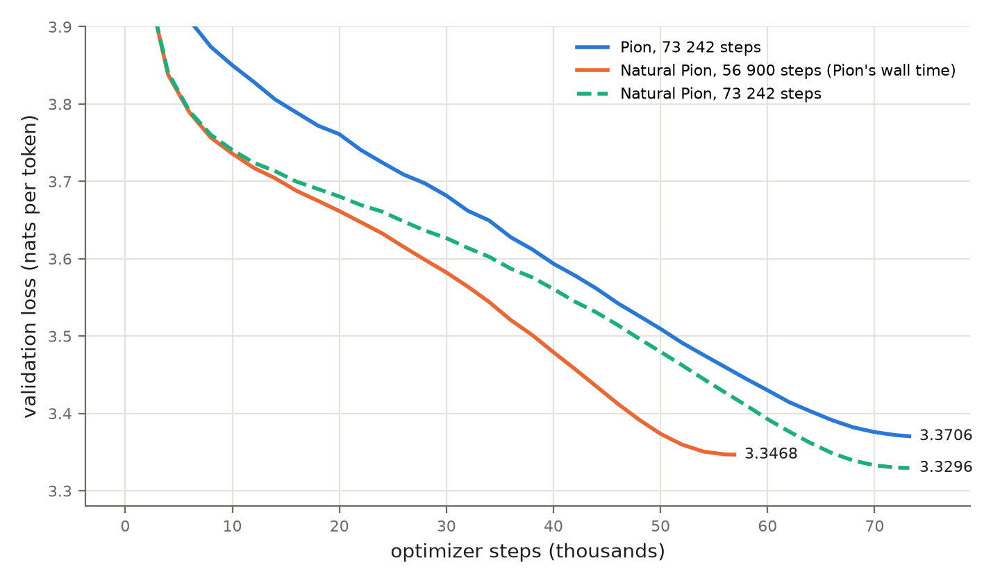
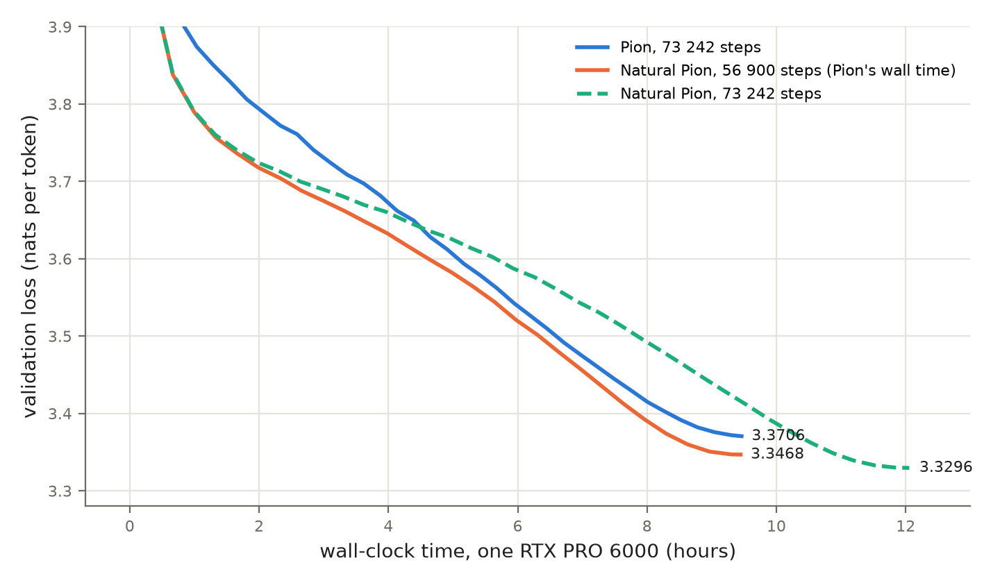

## Abstract

Pion trains each weight matrix of a language model only by rotating it on both sides,
$W \leftarrow R_{\mathrm{out}} W R_{\mathrm{in}}$, so the singular values of every matrix stay fixed for the
whole run. We keep this constraint and change the direction of the rotation from the gradient to the
natural gradient. On LLaMA-60M trained on 9.6B tokens of C4, the resulting optimizer, **Natural Pion**,
reaches a validation loss of 3.3296 in Pion's number of steps, against Pion's 3.3706. At Pion's
wall-clock time it reaches 3.3468. It needs at least 1.41x fewer steps to reach Pion's final loss, and it
is ahead at equal wall-clock time on every seed and horizon we measured.

The method rests on three results. First, on the rotation generators the Kronecker-factored (K-FAC)
Fisher information takes a closed form, $F(X) = \tfrac12(SXA + AXS)$. Here $A$ is the second moment of
the layer's inputs and $S$ that of its output gradients pulled back through $W$. A single generalized
eigendecomposition per side inverts this operator exactly. Second, the natural gradient is a good
direction with a bad scale: its magnitude varies over orders of magnitude between layers. We keep the
direction and set the length so that every matrix turns its fastest rotation plane by the same scheduled
angle. Third, an exact Cayley retraction keeps Pion's invariant exactly rather than approximately. A fast
form of the method costs 1.28x Pion's time per step.

---

## 1 Introduction

Most optimizers for neural networks move a weight matrix additively, $W \leftarrow W - \eta\,\Delta$.
They differ in how $\Delta$ is preconditioned: per coordinate (Adam), by Kronecker factors (K-FAC,
Shampoo), or by orthogonalizing it (Muon). Pion (Shi et al., 2026) takes a different route. It
updates $W$ multiplicatively, by an orthogonal equivalence transformation

$$W \leftarrow R_{\mathrm{out}}\, W\, R_{\mathrm{in}}, \qquad R_{\mathrm{out}} \in O(m),\; R_{\mathrm{in}} \in O(n),$$

so the singular values of $W$ are those it was initialised with, for the whole of training. Only
the singular vectors are learned. Pion reports that this gives spectral control without explicit
normalization, stable training, and performance competitive with AdamW and Muon.

Pion chooses the rotation by steepest descent on the rotation group: it follows the Riemannian
gradient of the loss with respect to the two generators. Steepest descent depends on the metric, and
Pion's is the Euclidean one on the generators, which treats every direction of rotation alike. One
global RMS normalisation then sets the step for each matrix. But the curvature of the loss along
different rotation directions, and across layers, differs by orders of magnitude. The classical remedy
is the natural gradient (Amari, 1998): steepest descent in the metric of the model's output
distribution, the Fisher information. It accounts for these differences and is invariant to how the
rotation is parameterised. This paper derives the natural gradient for Pion's parameterization, makes
it exact and cheap, and pairs it with a step-length rule that keeps the stability Pion's normalisation
provides.

**Contributions.**

1. **The Fisher on rotation generators, in closed form.** Under the K-FAC independence
   approximation, the Fisher information restricted to the rotations of $W$ is
   $F(X) = \tfrac12(SXA + AXS)$ on each side (Proposition 1). Its factors are the input second
   moment $A$ and the output-gradient second moment $D$, pulled through $W$. The structure has a
   simple origin: a single token's rotation gradient is a bivector, the wedge product of two vectors.
2. **Exact inversion.** One generalized eigendecomposition per side diagonalises $F$, and the
   solve becomes an elementwise division (Proposition 2). No damping is needed beyond a relative
   floor on the eigenvalues.
3. **Direction from the Fisher, length from an angle.** $F^{-1}$ amplifies gradients by four or more
   orders of magnitude, unevenly across layers. We take only its direction. The step length is set so
   that the largest rotation plane of every matrix turns by the same scheduled angle $\theta_t$
   (Proposition 3). With the same angle rule and the same momentum, the natural gradient reaches
   3.7032 at 3 000 steps against 3.8248 for Pion's raw generator (Pion itself:
   3.8412). The angle rule is what lets the natural gradient through: without momentum and with a
   fixed step size, $F^{-1}G$ reaches only 3.8419, against 3.7399 with the angle (Section 5.4).
4. **A retraction that is exact at large angles.** Natural Pion turns every matrix by the full scheduled
   angle at every step, so the retraction must stay orthogonal at angles of 0.05 to 0.2 rad. The Cayley
   transform is orthogonal at any angle and keeps the trained spectrum to 0.04% (median matrix,
   3 000 steps). Pion's truncated exponential is not orthogonal, $T^\top T = I + \Omega^4/4$ (Proposition 4),
   and moves it by 0.59%. A two-step Newton–Schulz inverse is exact enough in arithmetic but, in
   its usual form, rounds next to the identity with a positive bias in fp32 and inflates the spectrum by
   1.26%; carried in the correction $Z - I$ it keeps $\|W\|_F$ on bare matrices better than the Cayley solve,
   at the cost of matrix products only; its trained spectrum is **[ret_nsd_drift?]** (Section 3.4). On these horizons none of the three drifts changes the loss.
5. **A fast form.** Amortised refreshes, statistics collected only where they are read, a warm power
   iteration and batching take the step from 1.77 s to 0.596 s (Pion: 0.468 s). Each change is
   measured separately for time and loss (Section 4).
6. **Experiments.** On LLaMA-60M / C4 at Pion's full 9.6B-token budget, Natural Pion is ahead of
   Pion at equal steps by 0.041 and at equal wall-clock time by 0.024 in validation loss. It is ahead
   on four of four seeds at two shorter horizons, and needs at least 1.41x fewer steps. Ablations
   isolate each component.

---

## 2 Background

### 2.1 Pion: training by orthogonal equivalence

Let $W \in \mathbb{R}^{m \times n}$ be a weight matrix with loss gradient $G = \partial L / \partial W$.
Pion parameterises an update by two skew-symmetric generators,
$\Omega_{\mathrm{in}} \in \mathfrak{so}(n)$ and $\Omega_{\mathrm{out}} \in \mathfrak{so}(m)$, and moves

$$W(\Omega) = e^{\Omega_{\mathrm{out}}}\, W\, e^{\Omega_{\mathrm{in}}}.$$

The derivative at $\Omega = 0$ is $\Omega_{\mathrm{out}} W + W \Omega_{\mathrm{in}}$. Write
$\langle M, N \rangle = \operatorname{tr}(M^\top N)$ and $\operatorname{skew}(M) = \tfrac12(M - M^\top)$.
For skew $\Omega$, $\langle M, \Omega\rangle = \langle \operatorname{skew}(M), \Omega\rangle$, so

$$dL = \langle G W^\top, \Omega_{\mathrm{out}}\rangle + \langle W^\top G, \Omega_{\mathrm{in}}\rangle
\quad\Longrightarrow\quad
G_{\mathrm{in}} = \operatorname{skew}(W^\top G), \qquad G_{\mathrm{out}} = \operatorname{skew}(G W^\top)$$

are the gradients of the loss with respect to the two generators: the Riemannian gradient on
$O(m) \times O(n)$ at the identity.

Pion steps along $-G_{\mathrm{in}}$ and $-G_{\mathrm{out}}$ with three further ingredients:

* **Lie-algebra momentum.** An exponential moving average of $G_{\mathrm{in}}$ and $G_{\mathrm{out}}$.
* **RMS scaling.** The step is scaled so that the RMS of the induced change
  $W\Omega_{\mathrm{in}} + \Omega_{\mathrm{out}} W$ equals a target (0.2 times the learning rate).
* **A truncated exponential retraction** $e^{\Omega} \approx I + \Omega + \Omega^2/2$.

Both rotations are applied at every step (the *bilateral* update; Pion also describes an alternating
variant, which it finds slightly worse at 60M). The query projection is rotated per attention head: each
head's block of rows is treated as a separate matrix. Embeddings, the output head and normalization
gains are trained by AdamW. Only the 2-D weights inside the transformer blocks are rotated.

**Why preserve the spectrum.** Pion motivates the constraint by what it buys, and these properties are
what Natural Pion inherits. The spectral norm of every weight is fixed by the dynamics, so no weight
decay or explicit normalisation is needed to control it. Pion reports that a 60M model without
normalization layers trains stably to the end of its 9.6B-token budget, where AdamW and Muon diverge to
NaN. It also reports that the optimal learning rate transfers across model widths (a μP-compatible
variant), and that the minimum hyperspherical energy of the Gaussian initialisation is preserved
throughout training. At 1.3B parameters and 54B tokens it is within 0.0125 of Muon in validation loss
and ahead of AdamW and Muon on downstream benchmarks. Pion establishes the constraint. This paper is about
the direction of motion inside it.

### 2.2 The natural gradient and K-FAC

For a model with predictive distribution $p_\phi(y \mid x)$, the Fisher information
$F = \mathbb{E}[\nabla_\phi \log p\, \nabla_\phi \log p^\top]$ defines a metric on parameter space. The
natural gradient $F^{-1}\nabla L$ is the steepest-descent direction in that metric (Amari, 1998):

$$-F^{-1}\nabla L \;\propto\; \arg\min_{\Delta}\; \langle \nabla L, \Delta\rangle
\quad \text{s.t.} \quad \tfrac12 \Delta^\top F \Delta \le \varepsilon .$$

In a language model the "examples" of this expectation are token positions. A linear layer $y = Wx$
sees one input vector $x_t$ and receives one output gradient $\delta_t = \partial \ell_t / \partial y_t$
per token $t$, and its weight gradient is the average of the per-token outer products
$\delta_t x_t^\top$. K-FAC (Martens & Grosse, 2015) assumes $x$ and $\delta$ are independent, which gives
$F_W \approx A \otimes D$ with $A = \mathbb{E}_t[x_t x_t^\top]$ and $D = \mathbb{E}_t[\delta_t\delta_t^\top]$.
As an operator on matrices, $F_W(V) = D V A$.

Strictly, the Fisher averages over outputs $y$ sampled from the model. Like most K-FAC
implementations, we use the **empirical Fisher**: $\delta_t$ is the gradient of the training loss at
the observed next token. In an earlier variant of our method, sampling the targets from the model
instead gave 3.9102 against 3.9091 at 3 000 steps.

---

## 3 Method

### 3.1 The Fisher on rotation generators

We derive the Fisher of the input-side generator $\Omega_{\mathrm{in}} \in \mathfrak{so}(n)$ in four
steps: write it as the covariance of the per-token gradients in the skew space, expand it, apply the
K-FAC assumption, and simplify. The output side follows by symmetry.

**Step 1: the Fisher as a covariance on $\mathfrak{so}(n)$.** By Section 2.1, the gradient of token
$t$'s loss with respect to $\Omega_{\mathrm{in}}$ is

$$g_t = \operatorname{skew}(W^\top \delta_t\, x_t^\top) \in \mathfrak{so}(n).$$

The (empirical) Fisher on $\mathfrak{so}(n)$ is the second moment of $g_t$. A second moment of
elements of a vector space is a linear operator on that space:

$$F_{\mathrm{in}}(X) = \mathbb{E}_t\big[\langle g_t, X\rangle\, g_t\big], \qquad X \in \mathfrak{so}(n),$$

so that $\langle X, F_{\mathrm{in}}(X)\rangle = \mathbb{E}_t[\langle g_t, X\rangle^2]$ is the variance of
the directional derivative along $X$. In coordinates this is an $\tfrac{n(n-1)}{2} \times
\tfrac{n(n-1)}{2}$ matrix, about $1.7\cdot10^{10}$ entries for $n = 512$, and it cannot be stored, let
alone inverted.

**Step 2: each token's generator is a bivector.** Write $u_t = W^\top \delta_t \in \mathbb{R}^n$, the
output gradient pulled back to the input space. Then

$$g_t = \tfrac12\big(u_t x_t^\top - x_t u_t^\top\big) = \tfrac12\, u_t \wedge x_t,$$

the antisymmetrised outer product of two vectors. Its pairing with a skew $X$ is a single bilinear
form: since $x^\top X u = -u^\top X x$,

$$\langle g_t, X\rangle = \tfrac12\big(u_t^\top X x_t - x_t^\top X u_t\big) = u_t^\top X x_t .$$

**Step 3: expand.** Substituting both expressions into Step 1 and moving the scalar
$u_t^\top X x_t$ next to the vector it pairs with:

$$F_{\mathrm{in}}(X) = \tfrac12\,\mathbb{E}_t\big[(u_t^\top X x_t)\, u_t x_t^\top\big]
- \tfrac12\,\mathbb{E}_t\big[(u_t^\top X x_t)\, x_t u_t^\top\big]
= \tfrac12\,\mathbb{E}_t\big[u_t u_t^\top\, X\, x_t x_t^\top\big]
- \tfrac12\,\mathbb{E}_t\big[x_t x_t^\top\, X^\top u_t u_t^\top\big].$$

Each term is now a product of a quantity that depends on $u_t$ only, $X$, and a quantity that depends
on $x_t$ only.

**Step 4: the K-FAC assumption.** Assume, as K-FAC does, that the layer's input $x_t$ and its output
gradient $\delta_t$ (hence $u_t$) are independent. The expectation of each product then factorises:

$$\mathbb{E}_t\big[u u^\top X x x^\top\big] = \mathbb{E}[u u^\top]\, X\, \mathbb{E}[x x^\top] = S X A,
\qquad
\mathbb{E}_t\big[x x^\top X^\top u u^\top\big] = A X^\top S,$$

with $A = \mathbb{E}[x x^\top]$ and $S = \mathbb{E}[u u^\top] = W^\top \mathbb{E}[\delta\delta^\top] W = W^\top D W$.

**Step 5: simplify.** With $X^\top = -X$ the two terms add:

$$F_{\mathrm{in}}(X) = \tfrac12\big(S X A - A X^\top S\big) = \tfrac12\big(S X A + A X S\big).$$

**The output side.** For $\Omega_{\mathrm{out}} \in \mathfrak{so}(m)$, token $t$'s generator is
$\operatorname{skew}(\delta_t x_t^\top W^\top) = \tfrac12\,\delta_t \wedge v_t$ with $v_t = W x_t$, the input
pushed forward to the output space. Steps 2-5 are unchanged with $(u, x)$ replaced by $(v, \delta)$, and
$\mathbb{E}[v v^\top] = W A W^\top$.

**Proposition 1 (Fisher on the generators).** Under the K-FAC independence assumption, and treating
the two sides separately,

$$F_{\mathrm{in}}(X) = \tfrac12\big(S X A + A X S\big), \qquad S = W^\top D W,$$
$$F_{\mathrm{out}}(Y) = \tfrac12\big(D Y V + V Y D\big), \qquad V = W A W^\top,$$

for $X \in \mathfrak{so}(n)$, $Y \in \mathfrak{so}(m)$. Both operators are self-adjoint and positive
semi-definite on the skew matrices: $\langle Z, SXA + AXS\rangle$ is symmetric in $X$ and $Z$, and
$\langle X, F_{\mathrm{in}}(X)\rangle = \mathbb{E}[(u^\top X x)^2] \ge 0$ before the factorisation and
$\tfrac12\langle X, SXA + AXS\rangle = \|S^{1/2} X A^{1/2}\|_F^2 \ge 0$ after it. $\square$

**Relation to K-FAC.** The operator we derived turns out to be K-FAC itself, written on the rotation
generators. The change of $W$ caused by a generator is $J(\Omega) = W\Omega$, whose adjoint onto
$\mathfrak{so}(n)$ is $J^*(M) = \operatorname{skew}(W^\top M)$. Pulling K-FAC's Fisher on $W$,
$F_W(V) = DVA$, back through this map gives

$$J^* F_W J(X) = \operatorname{skew}(W^\top D\, W X\, A) = \operatorname{skew}(S X A) = \tfrac12\big(SXA + AXS\big),$$

which is Proposition 1. So nothing beyond K-FAC's own assumption enters. What the derivation adds is
the form the operator takes on the generators, and the reason it keeps a Kronecker-like structure
there: each token contributes a bivector of two independent vectors. That form decides how the operator
is inverted (Section 3.2). It is not a Kronecker product, so K-FAC's inverse
$D^{-1} V A^{-1}$ does not apply.

**Remarks.**

* **What is approximated.** Three things: the independence of $x$ and $\delta$ (Step 4, as in K-FAC);
  the coupling between the two sides and between layers (dropped); and the empirical Fisher in place
  of the true one (Section 2.2). Everything after Step 4 is exact algebra.
* **Size.** The operator of Step 1 has $O(n^4)$ entries. Proposition 1 fixes it by two $n \times n$
  matrices.
* **The output gradient enters both sides.** It appears on the input side through $S = W^\top D W$,
  and the input moment appears on the output side through $V = W A W^\top$. If $D$ is replaced by $I$
  (no backward statistic), the two sides receive the wrong relative scale (Appendix B).
* **Block-diagonal approximation.** We drop the coupling between $\Omega_{\mathrm{in}}$ and
  $\Omega_{\mathrm{out}}$ and between layers. K-FAC drops the coupling between layers in the same way.
* **Numerical check.** We checked Proposition 1 against a Monte Carlo estimate with independent $x$
  and $\delta$: relative error 0.7% (in) and 0.4% (out) at $4 \times 10^5$ samples, which is
  sampling noise. The pull-back identity holds to 4e-15 (`scripts/analysis/check_fisher.py`).

### 3.2 Exact inversion

$F_{\mathrm{in}}$ acts on a space of dimension $n(n-1)/2$. Solving $F_{\mathrm{in}}(X) = G$ as a dense
linear system costs $O(n^6)$, about $10^{16}$ operations for $n = 512$, at every refresh of every matrix.
Nor is $F_{\mathrm{in}}$ the map $X \mapsto SXA$, whose inverse would be $S^{-1} G A^{-1}$: the sum of the
two orderings does not factor unless $S$ and $A$ commute. It is nonetheless diagonalised by a
congruence, which brings the cost to $O(n^3)$.

**Proposition 2 (Inversion).** Let $A \succ 0$ and $S \succeq 0$, and let $P$ solve the generalized
eigenproblem $P^\top A P = I$, $P^\top S P = \Lambda = \operatorname{diag}(\lambda)$. For skew $G$, the
unique skew solution of $F_{\mathrm{in}}(X) = G$ with $\lambda_i + \lambda_j > 0$ is

$$X = P\, \big[ (P^\top G P) \oslash K \big]\, P^\top, \qquad K_{ij} = \tfrac12(\lambda_i + \lambda_j),$$

where $\oslash$ is elementwise division.

*Proof.* Substitute $X = PYP^\top$:
$P^\top (SXA + AXS) P = (P^\top S P)\, Y\, (P^\top A P) + (P^\top A P)\, Y\, (P^\top S P) = \Lambda Y + Y \Lambda$.
So $F_{\mathrm{in}}(X) = G$ becomes $\tfrac12(\lambda_i + \lambda_j)\, Y_{ij} = (P^\top G P)_{ij}$. Since
$P^\top G P$ is skew, so are $Y$ and $X$. $P$ is invertible, so the solution is unique. $\square$

**Computation.** We compute $P = A^{-1/2} Q$, with $Q$ the eigenvectors of $A^{-1/2} S A^{-1/2}$. The
symmetric root, rather than a Cholesky factor, exposes the eigenvalues so they can be floored.

**Regularisation.** It is a single relative floor: every spectrum that reaches a denominator ($A$, $S$
and $\Lambda$) is raised to at least $\varepsilon \lambda_{\max}$, with $\varepsilon = 10^{-4}$. A
floor leaves every eigenvalue above it exact, which an additive shift does not.

**Cost.** One generalized eigendecomposition per side, $O(n^3)$, recomputed every $T_{\mathrm{fac}}$
steps. Each step then costs four matrix products per side.

The same construction applies to the output side, with $A$ replaced by $D$ and $S$ by $V = WAW^\top$.

### 3.3 Step length as a rotation angle

The natural gradient fixes a direction $X = F^{-1}G$. Its length in the Fisher metric,
$\sqrt{\langle X, F X\rangle}$, is the classical trust-region measure, and it is a poor one here. In
our model, $F^{-1}$ scales the gradient very unevenly across layers. With a fixed step size, the
rotation angle actually taken spans 4.2e+06 across the 56 matrices (90th over 10th
percentile, Section 5.4): some matrices barely move while others turn by large angles.

The scale is also where K-FAC is least reliable: along our step, its curvature is 0.034 of the
exact per-token curvature on a trained model (Section 7). We use the geometry of the parameterization instead. The step is a rotation, and a rotation has an
angle.

**Proposition 3 (Angle of a Cayley step).** Let $X$ be skew with largest singular value $\sigma$ and
$c > 0$. The rotation $R = \big(I + \tfrac c2 X\big)^{-1}\big(I - \tfrac c2 X\big)$ turns its planes by
the angles $2\arctan(c\,\sigma_k/2)$, where $\sigma_k$ are the singular values of $X$. Its largest
angle is $2\arctan(c\sigma/2) = c\sigma + O((c\sigma)^3)$.

*Proof.* A real skew matrix has eigenvalues $\pm i\sigma_k$, in planes that are mutually orthogonal.
On such a plane $R$ acts by $(1 - ic\sigma_k/2)/(1 + ic\sigma_k/2) = e^{-2i\arctan(c\sigma_k/2)}$.
$\square$

We set

$$c_t = \frac{\theta_t}{\sigma}, \qquad \sigma = \max\big(\|X_{\mathrm{in}}\|_2,\ \|X_{\mathrm{out}}\|_2\big),$$

so the fastest rotation plane of every matrix turns by $2\arctan(\theta_t/2) \approx \theta_t$ radians
at step $t$. Because $2\arctan(\cdot/2) < \pi$, no Cayley step turns any plane by $\pi$ or more,
however large $c$ is: an outsized step saturates instead of overshooting.

**Corollary (the angle bounds the change of $W$).** With $c_t = \theta_t/\sigma$,
$$\|R_{\mathrm{out}} W R_{\mathrm{in}} - W\|_2 \le 2\,\theta_t\,\|W\|_2 .$$

*Proof.* $R$ is orthogonal with eigenvalues $e^{\pm i\varphi_k}$, so
$\|R - I\|_2 = \max_k |e^{i\varphi_k} - 1| = 2\sin(\varphi_{\max}/2) \le \varphi_{\max} \le \theta_t$ for both
sides (both share $c_t$, and each side's largest singular value is at most $\sigma$). Then
$R_{\mathrm{out}} W R_{\mathrm{in}} - W = (R_{\mathrm{out}} - I)\,W R_{\mathrm{in}} + W\,(R_{\mathrm{in}} - I)$. $\square$

So the angle rule is a bound on the relative change of every weight in spectral norm, the quantity that
Muon-style methods and the modular-norm view (Bernstein & Newhouse, 2024) control directly. Here it
follows from the geometry of the rotation. The
other planes turn in proportion to their singular values, so the natural gradient's own ranking of
directions within a matrix is kept. $\theta_t$ follows a cosine schedule from a peak $\theta_0$.

Two design points matter, each tested in Section 5.4:

* **The norm is taken after $F^{-1}$, not before.** Normalising the raw gradient and then applying
  $F^{-1}$ lets $F^{-1}$'s uneven scale back into the step.
* **One $\sigma$ for both sides of a matrix.** The two sides come from one block-diagonal Fisher, and
  the ratio $F^{-1}$ sets between them is part of the direction. Normalising each side by its own
  $\sigma$ discards that ratio.

This is the same division of labour as *grafting* (Agarwal et al., 2020), which takes the direction
of one optimizer and the step size of another. Here the step size is not borrowed from another
optimizer. It is a property of the rotation itself.

### 3.4 Retraction and exact spectrum preservation

**Proposition 4.** For skew $\Omega$, the Cayley map $R = (I + \Omega)^{-1}(I - \Omega)$ is orthogonal
for every scale of $\Omega$. Hence $R_{\mathrm{out}} W R_{\mathrm{in}}$ has exactly the singular values
of $W$. The degree-2 truncated exponential $T = I + \Omega + \Omega^2/2$ satisfies
$T^\top T = I + \Omega^4/4$.

*Proof.* The eigenvalues of a real skew $\Omega$ are $\pm i\sigma_k$, so those of $I + \Omega$ are
$1 \pm i\sigma_k \neq 0$ and $I + \Omega$ is invertible. $I + \Omega$ and $I - \Omega$ commute, and
$(I \pm \Omega)^\top = I \mp \Omega$, so
$R^\top R = (I + \Omega)(I - \Omega)^{-1}(I + \Omega)^{-1}(I - \Omega) = I$. For $T$, expand with
$\Omega^\top = -\Omega$: the odd and quadratic terms cancel, leaving $\Omega^4/4$. $\square$

**What the retraction must do.** The requirement is orthogonality to round-off at the angles the method
takes, not the Cayley transform as such. The Cayley transform is a standard retraction on the orthogonal
group (Wen & Yin, 2013; Li et al., 2020), orthogonal at any angle, and it makes Proposition 3 exact; Pion
reports having considered it, with modest gains. A Newton–Schulz inverse with two iterations is orthogonal
to 5e-09 at angle 0.2 and 1e-06 at 0.4 (fp64, one step), so below fp32 round-off at our angles,
though not beyond (at 0.8, 3e-04); this is the error of the iteration, and it can only shrink the
spectrum, since $R = \mathrm{Cay} - 2(I + A)^{-1}A^{8}$ for two iterations. The truncated exponential departs from orthogonality by
$\varphi^4/4$ for a largest angle $\varphi$, and the departure only inflates the spectrum and compounds over steps.

The angles at stake differ in kind between the two methods. Pion's angles vary across matrices and steps: its
typical block turns by 0.026 rad per step (median over blocks; 90th over 10th percentile
2.0), and its largest block by up to 0.097 rad (first 1 058 steps of a
3 840-step run, `scripts/probes/pion_angles.py`). Natural Pion turns the largest plane of every matrix by
exactly $\theta_t$, 0.05 to 0.2 rad at the peak, on every matrix and every step. At 0.2 the truncated
exponential would change the singular values of every matrix by up to 4e-04 per step, at 0.05 by
2e-06, against about 1e-07 for Pion's typical block.

Measured, over 3 000 two-sided steps on a $256 \times 256$ test matrix at a cosine angle from 0.2, the largest
relative change of a singular value is 0.09% with Cayley, 0.04% with Newton–Schulz
(both fp32 round-off) and 4.50% with the truncated exponential. In training (Natural Pion
Fast, seed 0):

| retraction | val, 3 000 steps ($\theta_0$ 0.2) | val, 15 000 steps ($\theta_0$ 0.05) | spectrum moved after 3 000 steps (median / worst matrix) |
|---|---|---|---|
| Cayley | 3.7242 | 3.4720 | 0.04% / 0.29% |
| Newton–Schulz, 2 iterations | 3.7252 | 3.4724 | 1.26% / 1.77% |
| Newton–Schulz in correction form | **[ret_nsd_3000?]** (B200) | — | **[ret_nsd_drift?]** / **[ret_nsd_drift_max?]** |
| truncated exponential (Pion's) | 3.7217 | 3.4733 | 0.59% / 1.49% |

The loss does not separate the retractions at these horizons: all lie within the 0.003 that separates
the same run on two GPU types. The spectrum does. Only Cayley keeps it, and the truncated exponential moves it
as Proposition 4 predicts. Newton–Schulz moves it more, which its truncation error cannot do (the error
shrinks the spectrum, see above). The cause is rounding. Over the first 200 training steps $\|W\|_F^2$,
which a rotation keeps exactly, grows by a median 9.5e-06 per step with Newton–Schulz against
2.6e-07 with Cayley and 8.7e-07 with the truncated exponential, and falls on
0 of 200 steps; the matrix products run in true fp32 throughout and the power iteration is
accurate (median $\hat\sigma / \|X\|_2 = 0.9999$), so neither precision nor the angle explains
it (`scripts/probes/ns_diag.py`). On bare matrices the same bias appears: 200 applications of a $1376 \times
1376$ retraction at angle 0.05 change $\|W\|_F^2$ by +2.8e-04 with Newton–Schulz and
+3.4e-05 with Cayley (`scripts/probes/ns_rounding.py`). The iteration
$Z \leftarrow Z(2I - MZ)$ works with matrices close to the identity, whose entries next to 1 fp32 rounds
coarsely. Carrying the same iteration in the correction $z = Z - I$, with residual
$r = MZ - I = A + z + Az$ and update $z \leftarrow z - r - zr$, $R = I + 2z$, keeps nothing next to 1, and the
bias goes: the same test gives +1.6e-07, and $R$ agrees with the Cayley solve to
9e-07. It costs the
same four products per side as the usual form.

**Precision.** In practice the guarantee holds only if the solve runs in true fp32. TF32 matrix
products, the default on recent GPUs, move the spectrum by up to 0.37% over 200 steps at angle $10^{-2}$ in our
measurements, against 0.012% in true fp32. In fp32 the singular values of a trained Natural Pion model move from their initial values by at most
0.04% per matrix (median over the 56 matrices; worst matrix 0.29%, mean signed change
+0.03%) after 3 000 steps.

### 3.5 The algorithm

**Algorithm 1: Natural Pion** (exact form; one rotated matrix $W \in \mathbb{R}^{m\times n}$, all of
them processed alike). Everything is recomputed at every step; Section 4 makes it fast.

```
state:  A, D (EMAs of x x^T and of d d^T, fp32; initialised by their first observation),
        M_in, M_out (momentum, initialised at zero), bases (P, lambda) per side
every step t:
    theta_t <- theta_min + (theta_0 - theta_min) (1 + cos(pi t / T)) / 2         cosine, theta_min = 1e-5
    forward: A <- beta_A A + (1 - beta_A) mean_tokens(x x^T)
    backward: D <- beta_D D + (1 - beta_D) mean_tokens(d d^T)     d = per-token output gradient
    (P_in, lambda_in)   <- gen_eig(A, W^T D W)                      the bases (Prop. 2); every spectrum
                                                                    floored at eps * lambda_max
    (P_out, lambda_out) <- gen_eig(D, W A W^T)
    G_in  <- skew(W^T G);   G_out <- skew(G W^T)
    M_in  <- beta1 M_in  + (1 - beta1) G_in
    M_out <- beta1 M_out + (1 - beta1) G_out
    X_in  <- P_in  [ (P_in^T  M_in  P_in)  / K_in  ] P_in^T          K_ij = (lambda_i + lambda_j)/2
    X_out <- P_out [ (P_out^T M_out P_out) / K_out ] P_out^T
    sigma <- max(||X_in||_2, ||X_out||_2)                           warm-started power iteration
    c     <- theta_t / sigma
    W     <- Cay(c X_out) W Cay(c X_in),   Cay(Z) = (I + Z/2)^-1 (I - Z/2)
```

Embedding, output head and normalization gains use AdamW, as in Pion. The rotated matrices get no
weight decay: a rotation cannot change their norm, and their spectrum is fixed by construction.

$d$ is the gradient of one token's loss at the layer output. Autograd returns the gradient of the
batch-mean loss, which carries a factor $1/N$; in any case a constant factor in $A$ or $D$ scales $F$ by a
constant, which scales $X$ and $\sigma$ alike and cancels in $c X$, so the step does not depend on it. The
implementation (`ngd_pion/natural_pion.py`) uses the operator exactly as derived, with the factor
$\tfrac12$.

The floor $\varepsilon = 10^{-4}$ was re-tested on Natural Pion against other floors and against Tikhonov
damping (Section 5.4); it is the best of the settings tried.

---

## 4 Making it fast: Natural Pion Fast

Algorithm 1 costs 1.77 s per step in our setting, against Pion's 0.468 s. This section takes it to
0.596 s, one change at a time, and gives for each change what it saves and what it costs in loss. All
numbers are at 3 000 steps, seed 0, Lie momentum 0.9. Seconds per step are wall-clock time over steps of
the training runs themselves, evaluation every 500 steps included for every method, unless marked as
profiled.

### 4.1 Where the time goes

*Table 1. Seconds per step by part, GPU-synchronised timers (profiled; the synchronisation inflates
the parts slightly).*

| part | Algorithm 1 ($T_{\mathrm{fac}} = 1$) | $T_{\mathrm{fac}} = 25$ |
|---|---|---|
| basis refresh (generalized eigendecompositions) | 0.545 | 0.025 |
| spectral norm (power iteration) | 0.415 | 0.042 |
| Cayley retraction | 0.163 | 0.157 |
| $F^{-1}$ and the rest of the step | 0.052 | 0.050 |
| accumulating $A$ and $D$ | 0.136 | 0.136 |
| forward, backward, AdamW, data (not profiled) | 0.455 | 0.454 |
| whole step (profiled run) | 1.77 | 0.86 |

Forward, backward and AdamW are common to all methods. The profiled runs are 400 steps long and
synchronise the GPU around every part, so their whole-step times differ slightly from the training runs
quoted in the rest of this section.

### 4.2 Amortised refresh

The bases $(P, \lambda)$ are recomputed every $T_{\mathrm{fac}}$ steps instead of every step. In
between, $F^{-1}$ uses the last bases with the current $W$, $G$ and momentum. This is the standard
amortisation of K-FAC. It also removes most of the power-iteration cost: $X$ jumps at a refresh, so the
power iteration needs 50 iterations right after one and 2 otherwise.

| refresh | momentum | val | s / step |
|---|---|---|---|
| every step | none | 3.7399 | 1.76 |
| every 25 steps | none | 3.7799 (+0.040) | 0.84 |
| every step | 0.9 | 3.7032 | 1.77 |
| every 10 steps | 0.9 | 3.7034 (+0.000) | 0.80 |
| every 25 steps | 0.9 | 3.7227 (+0.019) | 0.84 |

Each row's angle is tuned separately. Without momentum a stale basis costs 0.040; momentum absorbs
half of it at $T_{\mathrm{fac}} = 25$ and all of it at $T_{\mathrm{fac}} = 10$. Over four seeds,
$T_{\mathrm{fac}} = 1$ averages 3.7089, $T_{\mathrm{fac}} = 10$ 3.7032 and $T_{\mathrm{fac}} = 25$ 3.7216.
At 15 000 steps the difference is gone: 3.4788 for $T_{\mathrm{fac}} = 1$, 3.4720 for 25.

### 4.3 Statistics only where they are read

Nothing but a refresh reads $A$ and $D$. So we accumulate them only in the 6 steps before each refresh,
which is 6 of every 25 steps, and shorten the EMA of $A$ from 0.95 to 0.5 so that the window dominates
it: an observation more than 6 steps old then carries less than 2% of the weight. The EMA of $D$ is 0.5
throughout.

| change ($T_{\mathrm{fac}} = 25$) | EMA of $A$ / $D$ | val | s / step |
|---|---|---|---|
| both every step (reference) | 0.95 / 0.5 | 3.7227 | 0.843 |
| $D$ only in the last 6 steps | 0.95 / 0.5 | 3.7272 | 0.788 |
| $A$ only in the last 6 steps | 0.5 / 0.5 | 3.7205 | 0.806 |
| **$A$ and $D$ only in the last 6 steps** | 0.5 / 0.5 | **3.7227** | **0.744** |
| $A$ every second step | 0.9025 / 0.5 | 3.7223 | 0.817 |
| $D$ with a longer EMA | 0.95 / 0.9, 0.95 | 3.7206 / 3.7201 | 0.851 / 0.844 |

Every change is within 0.005 of the reference, inside run-to-run noise. Neither the window nor the
factors' memory matters here, so we take the cheapest option. ($A$ every second step uses $0.95^2$ to keep
its time constant.)

### 4.4 A warm power iteration for $\sigma$

The exact spectral norm (`matrix_norm(X, 2)`) took 95% of the whole optimizer step on these shapes:
cuSOLVER falls back to a slow path on $1376 \times 1376$ matrices. Power iteration on $X^\top X$ costs
matrix-vector products only, 189x less. Cold power iteration converges badly on skew matrices,
whose singular values come in equal pairs: on a random $512 \times 512$ skew matrix its relative error
is 21.0% after one iteration, 6.1% after five and 0.5% after twenty. Warm-started from the previous step's
vector, one iteration reaches 2e-05. We run 50 iterations after a refresh and 2 otherwise.

### 4.5 Computing only what the step uses

The reference implementation also computed $\langle G, X\rangle$ and $\langle X, FX\rangle$ (four extra
products per side) for a trust ratio the final method does not use, plus per-layer diagnostics and a
backward probe for logging. Removing them leaves the trajectory **bit-identical**: training loss at
every logged step and validation loss over 300 steps match exactly. The step goes from 0.744 s to
**0.697 s**.

### 4.6 Batching by shape

The 56 rotated matrices come in a few shapes. $F^{-1}$ and the Cayley solves are run as one batched call
per size instead of one call per matrix. The mathematics is unchanged and only round-off differs:
3.7242 against 3.7227. The step goes from 0.697 s to **0.596 s**.

### 4.7 Cheaper statistics

In the 6 steps before a refresh every rotated matrix forms two grams, $A$ over its inputs and $D$ over
its output gradients, each over all 131 072 tokens of the step and in true fp32, so without tensor
cores.

**One $A$ per input.** The query, key and value projections read the same normalised input, and so do the
gate and up projections; their $A$ is one matrix, formed five times. Natural Pion Fast forms it once per
input tensor. The trajectory is bit-identical (`tests/test_natural_pion.py`).

**bf16 inputs.** Rounding the *assembled* $A$ to bf16 is not usable: on a trained model it pushes the
smallest eigenvalues through zero (Appendix A). Rounding the *inputs* is different: the gram of bf16
vectors is still a gram, so $A$ stays positive semidefinite, and the rounding adds a noise covariance of
relative size about $(2^{-9})^2 \approx 4 \cdot 10^{-6}$, far below the floor $10^{-4} \lambda_{\max}$. We round
activations and output gradients to bf16 and multiply them with fp32 accumulation and an fp32 result.

*On B200, 3 000 steps, seed 0, both with one $A$ per input:*

| statistics | val | s / step |
|---|---|---|
| fp32 inputs | 3.7246 | 0.498 |
| bf16 inputs | 3.7216 (-0.003) | 0.463 |

bf16 inputs save 0.035 s per step at no measurable cost at 3 000 steps; at 15 000 steps
(angle 0.05) the run gives **[stats_bf16_15k?]** against 3.4720 for fp32.

### 4.8 Tried and not adopted

* **Newton–Schulz instead of the Cayley solve, usual form: not adopted.** In training it inflates the
  spectrum by 1.26% over 3 000 steps through fp32 rounding (Section 3.4) while saving
  0.038 s per step (0.558 s against 0.596 s on RTX; the truncated exponential
  0.550 s). The correction form removes the bias at the same cost; its training run is
  pending. Two Newton–Schulz
  iterations for the inverse cost 0.27x the exact solve on these shapes. Their orthogonality error
  grows with the angle: in fp64, after one step, 5e-09 at angle 0.2, 1e-06 at 0.4 and
  3e-04 at 0.8. At our angles ($\le 0.2$) that is below fp32 round-off: after one step both sit at
  the floor (2e-06 Cayley, 1e-06 Newton–Schulz), and over 3 000 steps on a
  $256 \times 256$ test matrix the spectrum moves by 0.04% with Newton–Schulz and
  0.09% with Cayley: the test matrix is small and the bias, which grows with size and
  shrinking angle, hides in it. Above an angle it needs a guard that falls back to the exact solve.
* **Exact SVD to reshape the step's spectrum** (the polar step in Section 5.4): 6.8–7.8 s per step, and worse in
  loss.
* **A larger $T_{\mathrm{fac}}$ beyond 25** saves little: the refresh is already 0.025 s per step.

### 4.9 Summary

*Table 2. From Algorithm 1 to Natural Pion Fast.*

| step | s / step | val (3 000 steps, seed 0) |
|---|---|---|
| Algorithm 1 | 1.77 | 3.7032 |
| refresh every 25 steps (4.2) | 0.843 | 3.7227 |
| + statistics only before a refresh (4.3) | 0.744 | 3.7227 |
| + compute only what the step uses (4.5) | 0.697 | 3.7227 (bit-identical: yes) |
| **+ batching by shape (4.6)**: Natural Pion Fast | **0.596** | **3.7242** |
| Pion | 0.468 | 3.8412 |

**Algorithm 2: Natural Pion Fast.** It is Algorithm 1 with the bases refreshed every 25 steps; $A$ and
$D$ accumulated (EMA 0.5) only in the 6 steps before a refresh; $\sigma$ by warm power iteration (2
iterations, 50 after a refresh); $F^{-1}$ and Cayley batched by shape. At 3 000 steps it is 0.013
behind Algorithm 1 over four seeds. At 15 000 steps it is level or ahead. It is 3.0x faster per step
and 1.28x slower than Pion.[^cost] Its peak GPU memory is 42.8 GB against Pion's 42.3 GB (+0.5 GB for $A$, $D$, the bases
and the momentum). All results in Section 5 use it.

[^cost]: One number per quantity throughout: seconds per step are wall-clock time over steps of 3 000-
step runs (Natural Pion Fast, 0.596 s) and the 3 840-step Pion run (0.468 s), both
evaluating every 500 steps; Algorithm 1 is the 3 000-step run with momentum (1.77 s). The
full-length runs, which evaluate every 2 000 steps, give 0.598 s and 0.465 s, a ratio of
1.29; their wall times are the ones in Table 4.

---

## 5 Experiments

### 5.1 Setup

| | |
|---|---|
| model | LLaMA-style, 60M parameters: hidden 512, 8 layers, 8 heads, SwiGLU FFN 1376, RoPE, RMSNorm, vocabulary 32 100 (T5 tokenizer) |
| data | C4, sequence length 256, batch 512 sequences (131 072 tokens per step) |
| budget | 73 242 steps = 9.6B tokens: Pion's 60M budget |
| rotated | the 56 matrices inside the blocks (43.5% of parameters) |
| the rest | AdamW, lr 8e-3, betas (0.9, 0.95), weight decay 0.1, cosine; the same for every method |
| precision | bf16 model; statistics, eigendecompositions and retractions in exact fp32 |
| metric | validation loss: token cross-entropy on held-out C4, in nats |
| hardware | one NVIDIA RTX PRO 6000 Blackwell per run; wall-clock time measured on the same node type for all |

**Baseline.** Pion in its published configuration: Lie momentum 0.9, RMS scale 0.2, truncated
exponential, query matrix split per head, bilateral update, lr $10^{-3}$ with a cosine schedule. The
Pion paper chose lr $10^{-3}$ from $\{10^{-4}, 5\cdot10^{-4}, 10^{-3}, 5\cdot10^{-3}, 10^{-2}\}$. We
checked it in our setting (Table 3). $10^{-3}$ is best at 19 200 steps. At 3 840 steps $2\cdot10^{-3}$
is better by 0.014, and we report that comparison too.

All comparisons are within one code base. Our Pion reaches 3.3706 at full length, against 3.3575
reported by the Pion paper in Megatron-LM. The difference is a harness offset we do not try to close.

**Natural Pion.** Natural Pion Fast (Algorithm 2, Section 4): $T_{\mathrm{fac}} = 25$; $A$ and $D$
accumulated (EMA 0.5) over the 6 steps before each refresh; Lie momentum 0.9; $\varepsilon = 10^{-4}$; cosine schedule on $\theta$ down to
$10^{-5}$. The peak angle $\theta_0$ is 0.2 at 3 000 steps and 0.05 from 15 000 steps on. The best peak
falls with the horizon; 0.05 was chosen on 15 000-step runs and kept for the full length, where the one
other value we ran, 0.025, is worse (3.3577 against 3.3468).

**Equal wall-clock time.** The step counts compared at equal time were fixed before the runs, from the
step times measured at the time (Pion 0.466 s, Natural Pion Fast 0.596 s): Pion's 73 242 steps
correspond to 57 169 of ours, run as 56 900; 3 840 and 19 200 Pion steps correspond to
3 000 and 15 000. The measured wall times (Table 4) agree.

**The query projection.** Pion rotates the query projection per attention head; all our Natural Pion
runs rotate it whole. With the per-head split, Natural Pion Fast reaches 3.7163 at 3 000 steps
against 3.7242 without it (-0.008, inside run-to-run noise), so the difference in
settings does not favour us.

Pion's learning rate was checked up to 19 200 steps; at the full length it is the published $10^{-3}$, not
re-tuned.

*Table 3. Pion learning rate (validation loss, seed 0).*

| Pion steps | 5e-4 | 1e-3 | 2e-3 | 4e-3 |
|---|---|---|---|---|
| 3 840 | 3.8397 | 3.7804 | **3.7668** | 4.1523 |
| 19 200 | - | **3.4960** | 3.5138 | 3.8802 |

### 5.2 Main result

*Table 4. Full length, seed 0.*

| run | steps | wall-clock | val loss |
|---|---|---|---|
| Pion | 73 242 | 34 063 s | 3.3706 |
| Natural Pion, Pion's wall-clock | 56 900 | 34 012 s | **3.3468** (-0.024) |
| Natural Pion, Pion's steps | 73 242 | 43 402 s | **3.3296** (-0.041) |





*Table 5. Equal wall-clock time, four seeds. Gap = val(Pion) - val(Natural Pion); positive means Natural
Pion is ahead. Pion runs as many steps as fit in Natural Pion's time.*

| budget | Pion steps | Natural Pion steps | seed 0 | seed 1 | seed 2 | seed 3 | mean |
|---|---|---|---|---|---|---|---|
| ~1 800 s | 3 840 | 3 000 | 0.056 | 0.059 | 0.049 | 0.057 | **0.055** |
| ~8 900 s | 19 200 | 15 000 | 0.024 | 0.023 | 0.020 | 0.034 | **0.025** |
| ~34 000 s | 73 242 | 56 900 | 0.024 | | | | |

Against Pion at its best short-horizon learning rate ($2\cdot10^{-3}$, seed 0), the 1 800 s gap is 0.043.

*Table 6. Equal number of steps.*

| steps | Pion | Natural Pion | gap |
|---|---|---|---|
| 3 000 (mean of 4 seeds) | 3.8394 | 3.7216 | 0.118 |
| 15 000 | 3.5254 | 3.4720 | 0.053 |
| 73 242 | 3.3706 | 3.3296 | 0.041 |

### 5.3 Steps to reach Pion's loss

For each Pion run, we find the first step at which a Natural Pion run reaches Pion's final validation
loss.

*Table 7. Steps to Pion's final loss (seed 0).*

| Pion steps | Pion val | Natural Pion reaches it at | ratio |
|---|---|---|---|
| 3 840 | 3.7804 | 2 398 | 1.60 |
| 4 500 | 3.7404 | 2 783 | 1.62 |
| 19 200 | 3.4960 | 12 907 | 1.49 |
| 73 242 | 3.3706 | 50 449 | 1.45 |

The crossing is interpolated linearly between two evaluations (every 500 steps in the short runs, every
2 000 in the full-length ones), so each ratio is known to an interval: 1.41–1.46 at
73 242 steps and 1.48–1.60 at 19 200. The crossing also happens mid-schedule, before the
Natural Pion run's cosine has decayed; a schedule fitted to that length would likely reach the loss
earlier, so we read the ratio as a lower bound. It is not a measurement with fitted schedules. The ratio does not
shrink with length. In settings where a step is expensive for reasons other than the optimizer (large
distributed batches, reinforcement learning with generation), steps rather than optimizer time are
the cost that matters.

### 5.4 Ablations

All ablations are at 3 000 steps, seed 0. They were run on the exact form or on the fast form as they
were developed, so each block states its setting and its reference. Where a row says "best", it is the
best of an angle grid; every such optimum is interior to its grid except where marked.

**The direction: natural gradient against the raw generator.** Algorithm 1 ($T_{\mathrm{fac}} = 1$),
best angle of each grid. Same normalisation, retraction and schedule; only $X = F^{-1}G$ against $X = G$
changes.

| | no momentum | Lie momentum 0.9 |
|---|---|---|
| $X = F^{-1}G$ | **3.7399** | **3.7032** |
| $X = G$ | 4.2007 | 3.8248 |
| gain from $F^{-1}$ | 0.461 | 0.122 |

Momentum supplies part of what $F^{-1}$ does, but not all of it. $X = G$ with momentum is close to Pion
(3.8412), as it should be.

**The length.** Algorithm 1 without momentum, best of each grid. All rules use the direction $F^{-1}G$. The
last column is the spread of the realised rotation angle across the 56 matrices (90th over 10th
percentile, after step 1000).

| length rule | val | angle spread |
|---|---|---|
| **spectral, after $F^{-1}$: $c = \theta/\sigma(F^{-1}G)$** | **3.7399** | 1 |
| RMS of the induced update, as in Pion | 3.7540 | 1.7 |
| quadratic-model ratio $\min(1, \langle G, X\rangle / \langle X, FX\rangle)$ | 3.7843 | 1.4e+02 |
| Fisher norm, $c = \theta / \sqrt{\langle X, FX\rangle}$ | $\le$ 3.8281 | 4.6e+04 |
| fixed $c$ | 3.8419 | 4.2e+06 |
| spectral, before $F^{-1}$: $c = \theta/\sigma(G)$ | 3.9952 | 3.4e+11 |

Across six rules, the more evenly the matrices turn, the lower the loss. The spectral rule beats the
RMS rule on all four seeds (gaps 0.014, 0.009, 0.011, 0.006). The Fisher-norm row is the best of its
grid at the edge of the range.

**Regularisation of the Fisher.** Natural Pion Fast, 3 000 steps, angle 0.2. The default is a relative floor
$\varepsilon = 10^{-4}$ (3.7242).

| floor $\varepsilon$ (no damping) | $10^{-6}$ | $10^{-5}$ | $10^{-3}$ | $10^{-2}$ |
|---|---|---|---|---|
| val | 3.8828 | 3.7804 | 3.7502 | 3.8853 |

| damping $\delta$ (floor $10^{-6}$; $F + \delta\lambda_{\max} BXB$) | $10^{-4}$ | $10^{-3}$ | $10^{-2}$ | $10^{-1}$ |
|---|---|---|---|---|
| val | 3.7376 | 3.7352 | 3.7650 | 3.7888 |

The floor at $10^{-4}$ is an interior optimum, and the best alternative is +0.011 worse.
Too little regularisation is as harmful as too much: at $10^{-6}$ the step follows directions the
statistics barely determine, and at $10^{-2}$ $F^{-1}$ moves toward the raw generator.

**Other choices.** Single runs at the reference's angle unless stated; the reference value is in brackets.
Rows with reference 3.7227 are on the fast form ($T_{\mathrm{fac}} = 25$, momentum, angle 0.2); rows with
reference 3.7399 on Algorithm 1 without momentum (angle 0.4).

| change | val |
|---|---|
| each side normalised by its own $\sigma$, best of angles 0.1 and 0.2 (3.7227) | 3.7412 |
| attention matrices at $\times 0.25 / 0.5 / 2 / 4$ the angle (3.7399) | 3.7876 / 3.7467 / 3.7600 / 3.7789 |
| constant angle; linear decay; warmup + cosine, best of 3 angles each (cosine 3.7399) | 3.8313; 3.7311; 3.7688 |
| linear decay on the fast form (cosine 3.7227) | 3.7229 |
| warmup-stable-decay, decay over the last 20% / 10% (3.7227) | 3.7578 / 3.7763 |
| equal angle on every plane of $X$ (polar step), at step 2499 (3.7291) | 3.7404 |

Linear decay and cosine are within noise of each other on both forms; we keep the cosine. The polar step
needs an SVD per matrix per step (6.8–7.8 s per step), and its runs could not finish within the
time limit, so it is compared at the last evaluation they all reached, step 2499, against Algorithm 1 with
momentum at the same step.

---

## 6 Related work

<!-- Checked 2026-11-03 against the method sections of FISMO, Go-MUON, ISO, POET-X, POET and 2207.07287
(arXiv HTML); the newer items (Mousse) from abstracts only. Re-run the novelty search before submission. -->

**Orthogonal equivalence training.** POET (Qiu et al., 2025) reparameterises $W = R W_0 P$ with orthogonal
$R$, $P$ built from skew-symmetric parameters by a truncated Cayley–Neumann series and trained with AdamW;
POET-X (Qiu et al., 2026) makes it memory-efficient with block-stochastic rotations. Pion (Shi et al.,
2026) turns the same principle into an optimizer, with updates in the Lie algebra. ISO (Zhu et al.,
2026) keeps the spectrum of a pretrained model fixed through a frame parameterisation $W = U\Sigma_0 V^\top$,
applies AdamW or Muon to the frames and retracts them by a polar map, for reinforcement learning from
verifiable rewards; it observes that "spectrum preservation alone does not determine optimization
quality; how the fixed-spectrum geometry is parameterized and optimized is consequential". None of these
uses a curvature metric on the orbit: they move along the gradient with a first-order or orthogonalised
preconditioner. Natural Pion keeps Pion's manifold and changes the metric to the Fisher.

**Natural gradient on manifolds and Kronecker factorisations.** The natural gradient (Amari, 1998) has a
long line of approximations. K-FAC (Martens & Grosse, 2015) factorises the Fisher of a layer into input
and output-gradient moments; Shampoo (Gupta et al., 2018) builds Kronecker factors from the gradient
itself. Riemannian natural gradient methods (Hu et al., 2024) define the Fisher on a manifold's tangent
space, use a retraction, and work out a K-FAC-style Kronecker approximation for Grassmann manifolds.
Natural Pion is an instance of that framework on a different manifold, the orbit of a matrix under
two-sided rotations. There the K-FAC Fisher on the generators is the two-term operator of Proposition 1
rather than a Kronecker product, and Section 3.2 inverts it exactly. We did not find this operator, or a
natural gradient for orthogonal-equivalence updates, in prior work.

**Curvature-aware orthogonalised updates.** A recent family puts Kronecker curvature into Muon's
additive step. FISMO (Xu et al., 2026) fits Kronecker factors to gradient outer products and takes
$W \leftarrow W - \eta P^{-1/2}\,\mathrm{Polar}(\tilde G)\, Q^{-1/2}$ under a spectral-norm trust region in that
metric. Go-MUON (Che, 2026) applies Muon between inverse fourth roots of K-FAC's activation and
output-gradient moments, and states that the result is "not a natural-gradient step". Mousse (2026) runs
Muon in Shampoo-whitened coordinates. All three are additive and change the weight spectrum; Natural
Pion's update is a rotation and keeps it.

**Orthogonalised additive updates.** Muon (Jordan et al., 2024) replaces the update by its orthogonal
polar factor, $W \leftarrow W - \eta\, UV^\top$, which equalises the update's singular values but
leaves the weight's spectrum free. It is additive and does not preserve the spectrum. Pion reports it
as competitive with Muon at 1.3B parameters.

**Step size from geometry.** Grafting (Agarwal et al., 2020) separates the direction of one optimizer
from the step size of another. Muon and the modular-norm view (Bernstein & Newhouse, 2024) set the
step in the spectral norm. Our length rule is spectral as well, but applied to the natural-gradient
generator. Its unit is the rotation angle, which the multiplicative update makes literal.

**Retractions on the orthogonal group.** The Cayley transform is a standard retraction on the
orthogonal and Stiefel manifolds (e.g. Wen & Yin, 2013; Li, Li & Todorovic, 2020). We use it for exact
preservation of the spectrum.

---

## 7 Limitations

* **Scale.** One model size (60M) and one data set. The full-length comparison is one seed; four seeds
  at shorter horizons agree in sign and size.
* **One code base.** Our Pion is 0.013 above the Pion paper's own number, so we compare within our
  harness only.
* **Exactness in practice.** The spectrum is frozen in exact arithmetic. In fp32 it drifts by up to 0.04% per matrix (median)
  over 3 000 steps, with a consistent sign. We have not measured whether this matters.
* **Only Pion as a baseline.** We compare against the published Pion configuration only, not against
  AdamW or Muon, and only on validation loss, not on downstream tasks.
* **The peak angle depends on the horizon.** The best peak falls with the training length (0.2 at 3 000
  steps, 0.05 from 15 000 on), so it has to be chosen for the budget, as a learning rate is.
* **The K-FAC assumption.** Along our step, the K-FAC curvature is 0.034 of the exact per-token
  curvature (median of three layers of a trained model): the independence of $x$ and $\delta$ fails by more
  than an order of magnitude in scale. This is consistent with Section 3.3: we keep the direction of
  $F^{-1}G$ but not its length.
* **Cost.** $O(n^3)$ eigendecompositions every $T_{\mathrm{fac}}$ steps and a Cayley solve every step.
  At 60M the step is 1.28x Pion's. For larger matrices the refresh must be amortised or distributed.
* **Steps-to-loss** (at least 1.41x) is a lower bound from mid-schedule crossings, not a measured ratio with
  fitted schedules.

**Future work.** Reinforcement learning from verifiable rewards, where a step costs minutes of
generation and the step efficiency of Section 5.3 is the relevant measure. The natural policy gradient
lineage (Kakade, 2001) makes it the natural test. Larger models, where the $O(n^3)$ refresh has to be
amortised over more steps or distributed across devices; at the shapes of a 1.7B model, one refresh
of all matrices takes 58 s on one B200.

---

## References

*(To be verified and completed before submission; arXiv identifiers as recorded in the project notes.)*

- Che, T. *Second-order Muon done right: a principled marriage of spectral geometry and curvature (Go-MUON).* arXiv:2608.09763, 2026.
- Hu, J., Ao, R., So, A. M.-C., Yang, M., Wen, Z. *Riemannian natural gradient methods.* SIAM J. Sci. Comput. 46(1), 2024; arXiv:2207.07287.
- Mousse. arXiv:2603.09697, 2026. *(abstract only; authors to add)*
- Qiu, Z., Liu, L., Weller, A., Shi, H., Liu, W. *POET-X: memory-efficient LLM training by scaling orthogonal transformation.* ICML 2026; arXiv:2603.05500.
- Xu, C., Yan, W., Zhang, Y.-J. A. *FISMO: Fisher-structured momentum-orthogonalized optimizer.* arXiv:2601.21750, 2026.
- Zhu, H., Cong, W., Sha, Z., et al. *ISO: an RLVR-native optimization stack.* arXiv:2607.19331, 2026.
- Agarwal, N., Anil, R., Hazan, E., Koren, T., Zhang, C. *Disentangling adaptive gradient methods from learning rates.* arXiv:2002.11803, 2020.
- Amari, S. *Natural gradient works efficiently in learning.* Neural Computation, 1998.
- Bernstein, J., Newhouse, L. *Old optimizer, new norm: an anthology.* 2024.
- Gupta, V., Koren, T., Singer, Y. *Shampoo: preconditioned stochastic tensor optimization.* ICML 2018.
- Jordan, K., et al. *Muon: an optimizer for hidden layers in neural networks.* 2024.
- Kakade, S. *A natural policy gradient.* NeurIPS 2001.
- Li, J., Li, F., Todorovic, S. *Efficient Riemannian optimization on the Stiefel manifold via the Cayley transform.* ICLR 2020, arXiv:2002.01113.
- Martens, J., Grosse, R. *Optimizing neural networks with Kronecker-factored approximate curvature.* ICML 2015, arXiv:1503.05671.
- Martin, C. H., Mahoney, M. W. *Implicit self-regularization in deep neural networks.* JMLR, 2021.
- Qiu, Z., Buchholz, S., Xiao, T. Z., Dax, M., Schölkopf, B., Liu, W. *Reparameterized LLM training via orthogonal equivalence transformation (POET).* NeurIPS 2025; arXiv:2506.08001.
- Shi, et al. *Pion: a spectrum-preserving optimizer via orthogonal equivalence transformation.* arXiv:2605.12492, 2026.
- Wen, Z., Yin, W. *A feasible method for optimization with orthogonality constraints.* Mathematical Programming, 2013.
- Raffel, C., et al. *Exploring the limits of transfer learning with a unified text-to-text transformer (C4, T5).* JMLR 2020.

---

## Appendix A: implementation details

* **Statistics.** $A$ is fed by a forward pre-hook on each rotated linear layer and $D$ by a hook on its
  output gradient, from one micro-batch per step. Both accumulate in fp32 with autocast disabled: a
  bf16 product that returns a bf16 matrix pushes the near-zero eigenvalues of $A$ below zero (measured
  at step 499: thousands of negative eigenvalues across the 56 layers). Rounding only the inputs and
  keeping fp32 accumulation and result (Section 4.7) does not, since the result is still a gram. The $1/N$ that autograd puts on a
  mean loss is undone by scaling $D$ by $N^2$; Algorithm 1 is invariant to it anyway.
* **Power iteration.** $\|X\|_2$ is estimated by power iteration on $X^\top X$, warm-started from the
  previous step's vector: 2 iterations per step and 50 after a refresh, where $X$ jumps. It is
  189x cheaper than an exact spectral norm on these shapes.
* **Floors.** $A$, $S$ (or $D$, $V$) and the pencil eigenvalues are floored at
  $10^{-4}\,\lambda_{\max}$ before any division.
* **Code.** `ngd_pion/natural_pion.py` (`NaturalPion`); every job and run record is listed in
  `scripts/paper/README.md` and `runs-record/`. Every number in this paper is computed from the run
  records by `scripts/analysis/paper_numbers.py` (the list, with sources, is `docs/paper/numbers.md`).

## Appendix B: why the output-gradient statistic is needed

If $D$ is taken to be the identity, $S = W^\top W$ and the step's scale per layer goes as
$\|\delta\| / (\|W\|\,\|x\|)$ instead of $1 / (\|W\|\,\|\delta\|\,\|x\|)$. The step is then largest
where the backward signal is strongest, the opposite of what curvature prescribes. In an earlier
variant that made this simplification, output projections rotated by angles several orders of magnitude
larger than query and key projections within the same step.

## Appendix C: hyperparameters

| | Natural Pion | Pion |
|---|---|---|
| rotated-matrix step | peak angle $\theta_0$ 0.2 (3k steps), 0.05 ($\ge$ 15k), cosine to $10^{-5}$ | lr $10^{-3}$, cosine to $10^{-5}$, RMS 0.2 |
| momentum | Lie, 0.9 | Lie, 0.9 |
| curvature | $T_{\mathrm{fac}}$ 25; $A$, $D$ EMA 0.5 over the 6 steps before a refresh; floor $10^{-4}$ | - |
| retraction | Cayley (exact fp32 solve) | truncated exponential, degree 2 |
| query projection | rotated whole (per head: Section 5.1) | rotated per head |
| update | both sides every step | both sides every step |
| other parameters | AdamW 8e-3, (0.9, 0.95), wd 0.1, cosine | same |
| gradient clipping | 1.0 | 1.0 |
| warmup | none | none |

## Appendix D: remarks

**The initial spectrum.** Under Pion and Natural Pion the singular values of a rotated matrix stay those
it was initialised with, so the initial spectrum is part of the trained model. We ran a short check with
a power-law tail in the initial spectrum: the largest 20% of the singular values of a
$\mathcal N(0, 0.02^2)$ matrix are replaced by $s_i \propto i^{-1/(2(\alpha-1))}$, the shape reported for
trained layers (Martin & Mahoney, 2021). It changes energy as well as shape.

| initial spectrum (3 000 steps, seed 0) | val | vs normal |
|---|---|---|
| $\mathcal N(0, 0.02^2)$ | 3.7242 | |
| tail, $\alpha$ = 2 / 2.5 / 3 / 4 / 5 | 3.7158 / 3.7049 / 3.7020 / 3.7145 / 3.7182 | best -0.022 |
| flat, all singular values $\sqrt{m/n}$ | 3.7701 | +0.046 |
| orthogonal, all singular values 1 | 3.7749 | +0.051 |

With $\alpha = 3$, Natural Pion gains 0.014 at 3 000 steps (mean of 4 seeds) and 0.004 at 15 000 steps (a
tie). The same initialisation makes Pion worse at every horizon tried (-0.006 at 3 000, -0.019 at 15 000
steps). Flat spectra are worse for Natural Pion by about 0.05. Every other experiment in the paper uses
$\mathcal N(0, 0.02^2)$.
