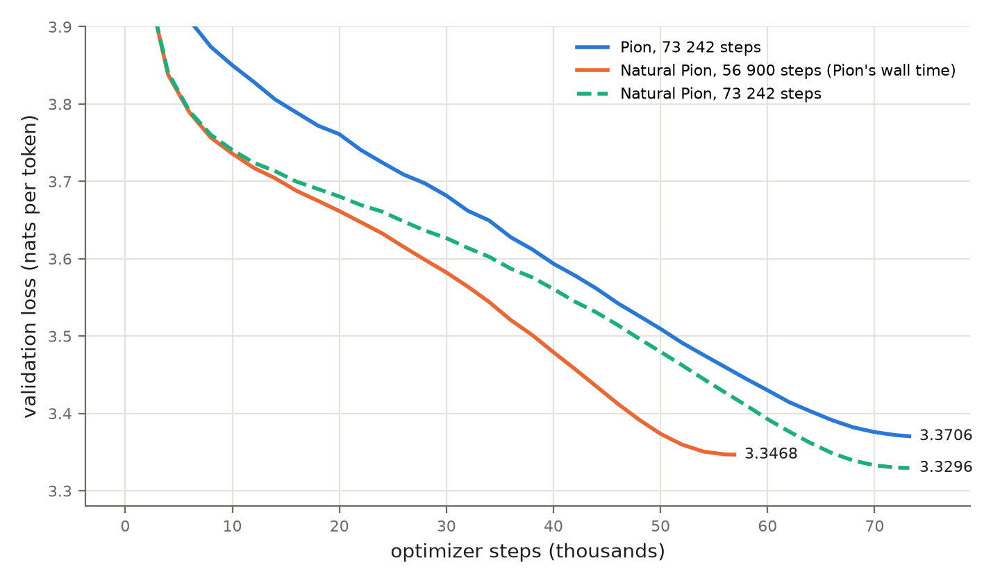
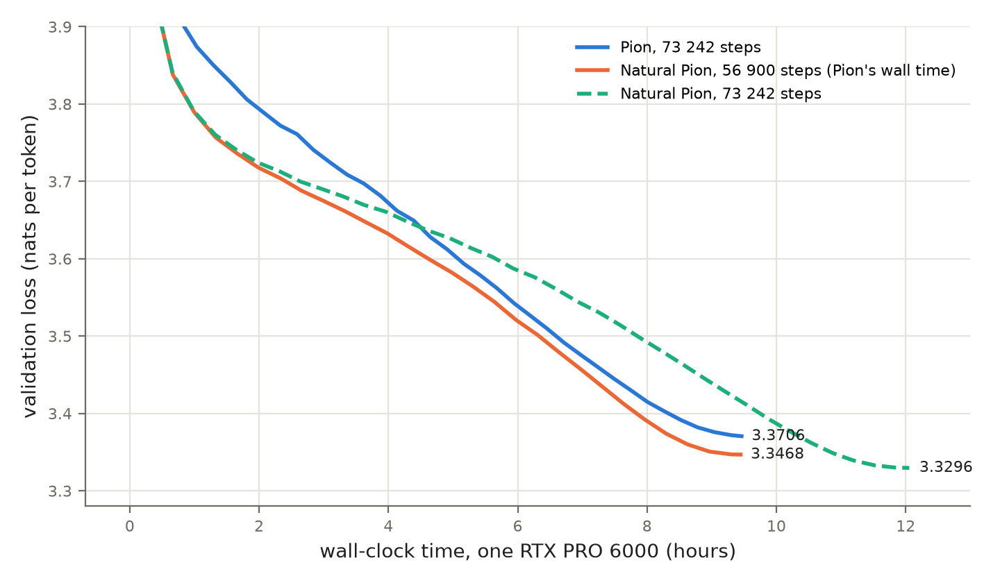

## Abstract

Pion trains each weight matrix of a language model only by rotating it on both sides,
$W \leftarrow R_{\mathrm{out}} W R_{\mathrm{in}}$, so the singular values of every matrix stay fixed for the
whole run. It drives the rotation with the raw gradient. We ask which direction to rotate in. On
the product of rotation groups that acts on $W$, the Kronecker-factored (K-FAC) Fisher information
takes a closed form, $F(X) = \tfrac12(SXA + AXS)$. Here $A$ is the second moment of the layer's
inputs, and $S$ is that of its output gradients pulled back through $W$. A single generalized
eigendecomposition per side inverts this operator exactly. The natural gradient it gives is a good
direction, but its scale varies over orders of magnitude between layers. We therefore keep the
direction and replace the length: every matrix turns its fastest rotation plane by the same
scheduled angle. An exact Cayley retraction completes the method, which we call **Natural Pion**.
It keeps Pion's invariant exactly rather than approximately. On LLaMA-60M trained on 9.6B tokens of
C4, Natural Pion reaches a validation loss of 3.3296 in Pion's number of steps, against Pion's
3.3706. At Pion's wall-clock time it reaches 3.3468, with a fast form whose step costs 1.28x Pion's. It needs at least 1.45x fewer steps to reach
Pion's final loss, and it is ahead at equal wall-clock time on every seed and horizon we measured.
Because the spectrum is frozen, the initial spectrum is a design choice: a heavy-tailed initial
spectrum helps Natural Pion and does not help Pion.

---

## 1 Introduction

Most optimizers for neural networks move a weight matrix additively, $W \leftarrow W - \eta\,\Delta$.
They differ in how $\Delta$ is preconditioned: per coordinate (Adam), by Kronecker factors (K-FAC,
Shampoo), or by orthogonalizing it (Muon). Pion (Shi et al., 2026) takes a different route. It
updates $W$ multiplicatively, by an orthogonal equivalence transformation

$$W \leftarrow R_{\mathrm{out}}\, W\, R_{\mathrm{in}}, \qquad R_{\mathrm{out}} \in O(m),\; R_{\mathrm{in}} \in O(n),$$

so the singular values of $W$ are those it was initialised with, for the whole of training. Only
the singular vectors are learned. Pion reports that this gives spectral control without explicit
normalization, stable training, and performance competitive with AdamW and Muon.

Pion moves along the raw Riemannian gradient on the rotation group. The geometry that motivates the
method, rotations of a matrix whose spectrum is fixed, says nothing about which rotation to take. The
classical answer to that question is the natural gradient (Amari, 1998): steepest descent in the
metric of the model's output distribution, not in the Euclidean metric of the parameters. This paper
derives the natural gradient for Pion's parameterization and makes it practical.

**Contributions.**

1. **The Fisher on rotation generators, in closed form.** Under the K-FAC independence
   approximation, the Fisher information restricted to the rotations of $W$ is
   $F(X) = \tfrac12(SXA + AXS)$ on each side (Proposition 1). Its factors are the input second
   moment $A$ and the output-gradient second moment $D$, pulled through $W$. The structure has a
   simple origin: a single token's rotation gradient is a bivector, the wedge product of two vectors.
2. **Exact inversion.** One generalized eigendecomposition per side diagonalises $F$, and the
   solve becomes an elementwise division (Proposition 2). No damping is needed beyond a relative
   floor on the eigenvalues.
3. **Direction from the Fisher, length from an angle.** $F^{-1}$ amplifies gradients by four or more
   orders of magnitude, unevenly across layers. We take only its direction. The step length is set so
   that the largest rotation plane of every matrix turns by the same scheduled angle $\theta_t$
   (Proposition 3). This one choice decides whether the natural gradient helps (Section 5.4).
4. **Exact spectrum preservation.** The Cayley retraction is orthogonal at every step size, so the
   invariant Pion is built on holds exactly. Pion's truncated exponential gives
   $R^\top R = I + \Omega^4/4$ (Proposition 4).
5. **A fast form.** Amortised refreshes, statistics collected only where they are read, a warm power
   iteration and batching take the step from 1.75 s to 0.596 s (Pion: 0.466 s). Each change is
   measured separately for time and loss (Section 4).
6. **Experiments.** On LLaMA-60M / C4 at Pion's full 9.6B-token budget, Natural Pion is ahead of
   Pion at equal steps by 0.041 and at equal wall-clock time by 0.024 in validation loss. It is ahead
   on four of four seeds at two shorter horizons, and needs at least 1.45x fewer steps. Ablations
   isolate each component. Because the spectrum is frozen, we also find that the shape of the
   initial spectrum matters: a power-law tail helps Natural Pion and hurts Pion.

---

## 2 Background

### 2.1 Pion: training by orthogonal equivalence

Let $W \in \mathbb{R}^{m \times n}$ be a weight matrix with loss gradient $G = \partial L / \partial W$.
Pion parameterises an update by two skew-symmetric generators,
$\Omega_{\mathrm{in}} \in \mathfrak{so}(n)$ and $\Omega_{\mathrm{out}} \in \mathfrak{so}(m)$, and moves

$$W(\Omega) = e^{\Omega_{\mathrm{out}}}\, W\, e^{\Omega_{\mathrm{in}}}.$$

The derivative at $\Omega = 0$ is $\Omega_{\mathrm{out}} W + W \Omega_{\mathrm{in}}$. Write
$\langle M, N \rangle = \operatorname{tr}(M^\top N)$ and $\operatorname{skew}(M) = \tfrac12(M - M^\top)$.
For skew $\Omega$, $\langle M, \Omega\rangle = \langle \operatorname{skew}(M), \Omega\rangle$, so

$$dL = \langle G W^\top, \Omega_{\mathrm{out}}\rangle + \langle W^\top G, \Omega_{\mathrm{in}}\rangle
\quad\Longrightarrow\quad
G_{\mathrm{in}} = \operatorname{skew}(W^\top G), \qquad G_{\mathrm{out}} = \operatorname{skew}(G W^\top)$$

are the gradients of the loss with respect to the two generators: the Riemannian gradient on
$O(m) \times O(n)$ at the identity.

Pion steps along $-G$ with three further ingredients:

* **Lie-algebra momentum.** An exponential moving average of $G_{\mathrm{in}}$ and $G_{\mathrm{out}}$.
* **RMS scaling.** The step is scaled so that the RMS of the induced change
  $W\Omega_{\mathrm{in}} + \Omega_{\mathrm{out}} W$ equals a target (0.2 times the learning rate).
* **A truncated exponential retraction** $e^{\Omega} \approx I + \Omega + \Omega^2/2$.

Embeddings, the output head and normalization gains are trained by AdamW. Only the 2-D weights inside
the transformer blocks are rotated.

### 2.2 The natural gradient and K-FAC

For a model with predictive distribution $p_\phi(y \mid x)$, the Fisher information
$F = \mathbb{E}[\nabla_\phi \log p\, \nabla_\phi \log p^\top]$ defines a metric on parameter space. The
natural gradient $F^{-1}\nabla L$ is the steepest-descent direction in that metric (Amari, 1998):

$$F^{-1}\nabla L \;\propto\; \arg\min_{\Delta}\; \langle \nabla L, \Delta\rangle
\quad \text{s.t.} \quad \tfrac12 \Delta^\top F \Delta \le \varepsilon .$$

For a linear layer $y = Wx$, a single example contributes the gradient $\delta x^\top$, where
$\delta = \partial \ell / \partial y$. K-FAC (Martens & Grosse, 2015) assumes $x$ and $\delta$ are
independent, which gives $F_W \approx A \otimes D$ with $A = \mathbb{E}[xx^\top]$ and
$D = \mathbb{E}[\delta\delta^\top]$. As an operator on matrices, $F_W(V) = D V A$.

---

## 3 Method

### 3.1 The Fisher on rotation generators

Consider the input side first. The map from the generator to the change in $W$ is
$J(\Omega) = W\Omega$, and its adjoint onto $\mathfrak{so}(n)$ is $J^*(M) = \operatorname{skew}(W^\top M)$.
The Fisher on the generator is the pull-back $J^* F_W J$.

**Proposition 1 (Fisher on the generators).** Under the K-FAC approximation, the Fisher
information with respect to $\Omega_{\mathrm{in}}$ and $\Omega_{\mathrm{out}}$ (each side taken
separately) is

$$F_{\mathrm{in}}(X) = \tfrac12\big(S X A + A X S\big), \qquad S = W^\top D W,$$
$$F_{\mathrm{out}}(Y) = \tfrac12\big(D Y V + V Y D\big), \qquad V = W A W^\top,$$

for $X \in \mathfrak{so}(n)$ and $Y \in \mathfrak{so}(m)$. Both operators are self-adjoint and positive
semi-definite on the skew matrices.

*Proof.* Input side:
$J^* F_W J(X) = \operatorname{skew}(W^\top D\, W X\, A) = \operatorname{skew}(S X A)
= \tfrac12(SXA - A X^\top S) = \tfrac12(SXA + AXS)$, using $X^\top = -X$.

The same result follows from per-example generators, which shows where the structure comes from. One
example's input-side generator is

$$g = \operatorname{skew}(W^\top \delta\, x^\top) = \tfrac12(u x^\top - x u^\top), \qquad u = W^\top\delta,$$

a bivector $u \wedge x$. For skew $X$, $\langle g, X\rangle = u^\top X x$. Hence

$$\mathbb{E}\big[\langle g, X\rangle\, g\big]
= \tfrac12\,\mathbb{E}\big[u u^\top X x x^\top\big] - \tfrac12\,\mathbb{E}\big[x x^\top X^\top u u^\top\big]
= \tfrac12\big(S X A + A X S\big),$$

where the last step uses the independence of $u$ and $x$. The output side is the same computation with
$g = \operatorname{skew}(\delta\, v^\top)$, $v = Wx$, and $\mathbb{E}[vv^\top] = WAW^\top$.

For self-adjointness, $\langle Z, SXA + AXS\rangle$ is symmetric in $X$ and $Z$. Positivity follows from
$\langle X, F_{\mathrm{in}}(X)\rangle = \mathbb{E}[(u^\top X x)^2] \ge 0$. $\square$

**Remarks.**

* **Size.** A general covariance on $\mathfrak{so}(n)$ has $O(n^4)$ entries. Here it is fixed by two
  $n \times n$ matrices. This is K-FAC's saving carried over to the rotation generators: the
  per-example generator is built out of two vectors.
* **The output gradient enters both sides.** It appears on the input side through $S = W^\top D W$,
  and the input moment appears on the output side through $V = W A W^\top$. If $D$ is replaced by $I$
  (no backward statistic), the two sides receive the wrong relative scale (Appendix B).
* **Block-diagonal approximation.** We drop the coupling between $\Omega_{\mathrm{in}}$ and
  $\Omega_{\mathrm{out}}$ and between layers. K-FAC drops the coupling between layers in the same way.
* **Numerical check.** We checked Proposition 1 against a Monte Carlo estimate with independent $x$
  and $\delta$: relative error 0.7% (in) and 0.4% (out) at $4 \times 10^5$ samples, which is
  sampling noise. The pull-back identity holds to $10^{-15}$.

### 3.2 Exact inversion

$F_{\mathrm{in}}$ is not the map $X \mapsto SXA$, whose inverse would be $S^{-1} G A^{-1}$. The sum of the
two orderings does not factor unless $S$ and $A$ commute. It is nonetheless diagonalised by a
congruence.

**Proposition 2 (Inversion).** Let $A \succ 0$ and $S \succeq 0$, and let $P$ solve the generalized
eigenproblem $P^\top A P = I$, $P^\top S P = \Lambda = \operatorname{diag}(\lambda)$. For skew $G$, the
unique skew solution of $F_{\mathrm{in}}(X) = G$ with $\lambda_i + \lambda_j > 0$ is

$$X = P\, \big[ (P^\top G P) \oslash K \big]\, P^\top, \qquad K_{ij} = \tfrac12(\lambda_i + \lambda_j),$$

where $\oslash$ is elementwise division.

*Proof.* Substitute $X = PYP^\top$:
$P^\top (SXA + AXS) P = (P^\top S P)\, Y\, (P^\top A P) + (P^\top A P)\, Y\, (P^\top S P) = \Lambda Y + Y \Lambda$.
So $F_{\mathrm{in}}(X) = G$ becomes $\tfrac12(\lambda_i + \lambda_j)\, Y_{ij} = (P^\top G P)_{ij}$. Since
$P^\top G P$ is skew, so are $Y$ and $X$. $P$ is invertible, so the solution is unique. $\square$

**Computation.** We compute $P = A^{-1/2} Q$, with $Q$ the eigenvectors of $A^{-1/2} S A^{-1/2}$. The
symmetric root, rather than a Cholesky factor, exposes the eigenvalues so they can be floored.

**Regularisation.** It is a single relative floor: every spectrum that reaches a denominator ($A$, $S$
and $\Lambda$) is raised to at least $\varepsilon \lambda_{\max}$, with $\varepsilon = 10^{-4}$. A
floor leaves every eigenvalue above it exact, which an additive shift does not.

**Cost.** One generalized eigendecomposition per side, $O(n^3)$, recomputed every $T_{\mathrm{fac}}$
steps. Each step then costs four matrix products per side.

The same construction applies to the output side with $(B, C) = (D, WAW^\top)$.

### 3.3 Step length as a rotation angle

The natural gradient fixes a direction $X = F^{-1}G$. Its length in the Fisher metric,
$\sqrt{\langle X, F X\rangle}$, is the classical trust-region measure, and it is a poor one here. In
our model, $F^{-1}$ multiplies the gradient by factors that range over four or more orders of
magnitude across layers. Single attention matrices would rotate by tens of radians while others
barely move.

We use the geometry of the parameterization instead. The step is a rotation, and a rotation has an
angle.

**Proposition 3 (Angle of a Cayley step).** Let $X$ be skew with largest singular value $\sigma$ and
$c > 0$. The rotation $R = \big(I + \tfrac c2 X\big)^{-1}\big(I - \tfrac c2 X\big)$ turns its planes by
the angles $2\arctan(c\,\sigma_k/2)$, where $\sigma_k$ are the singular values of $X$. Its largest
angle is $2\arctan(c\sigma/2) = c\sigma + O((c\sigma)^3)$.

*Proof.* A real skew matrix has eigenvalues $\pm i\sigma_k$, in planes that are mutually orthogonal.
On such a plane $R$ acts by $(1 - ic\sigma_k/2)/(1 + ic\sigma_k/2) = e^{-2i\arctan(c\sigma_k/2)}$.
$\square$

We set

$$c_t = \frac{\theta_t}{\sigma}, \qquad \sigma = \max\big(\|X_{\mathrm{in}}\|_2,\ \|X_{\mathrm{out}}\|_2\big),$$

so the fastest rotation plane of every matrix turns by $\approx \theta_t$ radians at step $t$. The
other planes turn in proportion to their singular values, so the natural gradient's own ranking of
directions within a matrix is kept. $\theta_t$ follows a cosine schedule from a peak $\theta_0$.

Two design points matter, each tested in Section 5.4:

* **The norm is taken after $F^{-1}$, not before.** Normalising the raw gradient and then applying
  $F^{-1}$ lets $F^{-1}$'s uneven scale back into the step.
* **One $\sigma$ for both sides of a matrix.** The two sides come from one block-diagonal Fisher, and
  the ratio $F^{-1}$ sets between them is part of the direction. Normalising each side by its own
  $\sigma$ discards that ratio.

This is the same division of labour as *grafting* (Agarwal et al., 2020), which takes the direction
of one optimizer and the step size of another. Here the step size is not borrowed from another
optimizer. It is a property of the rotation itself.

### 3.4 Retraction and exact spectrum preservation

**Proposition 4.** For skew $\Omega$, the Cayley map $R = (I + \Omega)^{-1}(I - \Omega)$ is orthogonal
for every scale of $\Omega$. Hence $R_{\mathrm{out}} W R_{\mathrm{in}}$ has exactly the singular values
of $W$. The degree-2 truncated exponential $T = I + \Omega + \Omega^2/2$ satisfies
$T^\top T = I + \Omega^4/4$.

*Proof.* $I + \Omega$ and $I - \Omega$ commute, and $(I \pm \Omega)^\top = I \mp \Omega$, so
$R^\top R = (I + \Omega)(I - \Omega)^{-1}(I + \Omega)^{-1}(I - \Omega) = I$. For $T$, expand with
$\Omega^\top = -\Omega$: the odd and quadratic terms cancel, leaving $\Omega^4/4$. $\square$

Pion's RMS scaling keeps $\Omega$ small, which keeps the $\Omega^4/4$ drift small. With Cayley, no such
constraint is needed for the invariant to hold.

**Precision.** In practice the guarantee holds only if the solve runs in true fp32. TF32 matrix
products, the default on recent GPUs, move the spectrum by a relative 1.0 over 200 steps in our
measurements. In fp32 the singular values of our trained models drift by about 0.2% over 3000 steps.

### 3.5 The algorithm

**Algorithm 1: Natural Pion** (exact form; one rotated matrix $W \in \mathbb{R}^{m\times n}$, all of
them processed alike). Everything is recomputed at every step; Section 4 makes it fast.

```
state:  A, D (EMAs of x x^T and of d d^T, fp32), M_in, M_out (momentum), bases (P, lambda) per side
every step t:
    forward: A <- beta_A A + (1 - beta_A) mean_tokens(x x^T)
    backward: D <- beta_D D + (1 - beta_D) mean_tokens(d d^T)     d = per-token output gradient
    (P_in, lambda_in)   <- gen_eig(A, W^T D W)                      the bases (Prop. 2)
    (P_out, lambda_out) <- gen_eig(D, W A W^T)
    G_in  <- skew(W^T G);   G_out <- skew(G W^T)
    M_in  <- beta1 M_in  + (1 - beta1) G_in
    M_out <- beta1 M_out + (1 - beta1) G_out
    X_in  <- P_in  [ (P_in^T  M_in  P_in)  / K_in  ] P_in^T          K_ij = (lambda_i + lambda_j)/2
    X_out <- P_out [ (P_out^T M_out P_out) / K_out ] P_out^T
    sigma <- max(||X_in||_2, ||X_out||_2)                           warm-started power iteration
    c     <- theta_t / sigma
    W     <- Cay(c X_out) W Cay(c X_in),   Cay(Z) = (I + Z/2)^-1 (I - Z/2)
```

Embedding, output head and normalization gains use AdamW, as in Pion. Any constant factor in $F$
cancels in $c$, so the method is invariant to the scale of $A$ and $D$, including the $1/N$ that
autograd puts on per-token gradients of a mean loss.

### 3.6 The initial spectrum is part of the model

Under Pion and Natural Pion the singular values of a rotated matrix are those it was initialised with,
to the end of training. The initial spectrum is therefore a design choice that persists, not a starting
point. Trained networks have heavy-tailed weight spectra (Martin & Mahoney, 2021), and HTMuon (2026)
argues that orthogonalising optimizers suppress such tails. With a frozen spectrum the tail cannot
emerge during training, but it can be set at initialisation. We test this in Section 5.5.

## 4 Making it fast: Natural Pion Fast

Algorithm 1 costs 1.75 s per step in our setting, against Pion's 0.466 s. This section takes it to
0.596 s, one change at a time, and gives for each change what it saves and what it costs in loss. All
numbers are at 3 000 steps, seed 0, Lie momentum 0.9. Seconds per step are measured on the training
runs themselves unless marked as profiled.

### 4.1 Where the time goes

*Table 1. Seconds per step by part, GPU-synchronised timers (profiled; the synchronisation inflates
the parts slightly).*

| part | Algorithm 1 ($T_{\mathrm{fac}} = 1$) | $T_{\mathrm{fac}} = 25$ |
|---|---|---|
| basis refresh (generalized eigendecompositions) | 0.545 | 0.025 |
| spectral norm (power iteration) | 0.415 | 0.042 |
| Cayley retraction | 0.163 | 0.157 |
| $F^{-1}$ and the rest of the step | 0.052 | 0.050 |
| accumulating $A$ and $D$ | 0.136 | 0.136 |
| whole step | 1.75 | 0.85 |

Forward, backward and AdamW are common to all methods and are not counted as overhead.

### 4.2 Amortised refresh

The bases $(P, \lambda)$ are recomputed every $T_{\mathrm{fac}}$ steps instead of every step. In
between, $F^{-1}$ uses the last bases with the current $W$, $G$ and momentum. This is the standard
amortisation of K-FAC. It also removes most of the power-iteration cost: $X$ jumps at a refresh, so the
power iteration needs 50 iterations right after one and 2 otherwise.

| refresh | momentum | val | s / step |
|---|---|---|---|
| every step | none | 3.7399 | 1.75 |
| every 25 steps | none | 3.7798 (+0.040) | 0.85 |
| every step | 0.9 | 3.7032 | 1.75 |
| every 10 steps | 0.9 | 3.7034 (+0.000) | 0.80 |
| every 25 steps | 0.9 | 3.7227 (+0.019) | 0.84 |

Each row's angle is tuned separately. Without momentum a stale basis costs 0.040; momentum absorbs
half of it at $T_{\mathrm{fac}} = 25$ and all of it at $T_{\mathrm{fac}} = 10$. Over four seeds,
$T_{\mathrm{fac}} = 1$ averages 3.7089, $T_{\mathrm{fac}} = 10$ 3.7032 and $T_{\mathrm{fac}} = 25$ 3.7216.
At 15 000 steps the difference is gone: 3.4788 for $T_{\mathrm{fac}} = 1$, 3.4720 for 25.

### 4.3 Statistics only where they are read

Nothing but a refresh reads $A$ and $D$. With EMA factor 0.5, an observation more than 6 steps old
carries less than 2% of the weight. So we accumulate $A$ and $D$ only in the 6 steps before each
refresh, which is 6 of every 25 steps.

| change ($T_{\mathrm{fac}} = 25$) | val | s / step |
|---|---|---|
| both every step (reference) | 3.7227 | 0.843 |
| $D$ only in the last 6 steps | 3.7272 | 0.788 |
| $A$ only in the last 6 steps | 3.7205 | 0.806 |
| **$A$ and $D$ only in the last 6 steps** | **3.7227** | **0.744** |
| $A$ every second step | 3.7223 | 0.817 |
| EMA of $D$ at 0.9 / 0.95 instead of 0.5 | 3.7206 / 3.7201 | 0.851 / 0.844 |

Every change is within 0.005 of the reference, inside run-to-run noise. The factor's memory does not
matter here, so we take the cheapest option.

### 4.4 A warm power iteration for $\sigma$

The exact spectral norm (`matrix_norm(X, 2)`) took 95% of the whole optimizer step on these shapes:
cuSOLVER falls back to a slow path on $1376 \times 1376$ matrices. Power iteration on $X^\top X$ costs
matrix-vector products only, 4 800x less. Cold power iteration converges badly on skew matrices,
whose singular values come in equal pairs: on a random $512 \times 512$ skew matrix its relative error
is 21% after one iteration, 6% after five and 0.5% after twenty. Warm-started from the previous step's
vector, one iteration reaches $10^{-4}$. We run 50 iterations after a refresh and 2 otherwise.

### 4.5 Computing only what the step uses

The reference implementation also computed $\langle G, X\rangle$ and $\langle X, FX\rangle$ (four extra
products per side) for a trust ratio the final method does not use, plus per-layer diagnostics and a
backward probe for logging. Removing them leaves the trajectory **bit-identical**: training loss at
every logged step and validation loss over 300 steps match exactly. The step goes from 0.744 s to
**0.697 s**.

### 4.6 Batching by shape

The 56 rotated matrices come in a few shapes. $F^{-1}$ and the Cayley solves are run as one batched call
per size instead of one call per matrix. The mathematics is unchanged and only round-off differs:
3.7242 against 3.7227. The step goes from 0.697 s to **0.596 s**.

### 4.7 Tried and not adopted

* **Newton–Schulz instead of the Cayley solve.** An iterative inverse costs 0.18x the exact solve on
  these shapes. Its orthogonality error grows with the angle: in fp64, after one step with two
  iterations it is $4\cdot10^{-8}$ at angle 0.2, $10^{-5}$ at 0.4 and $2\cdot10^{-3}$ at 0.8. In fp32,
  both methods sit at the round-off floor after one step ($1$–$3\cdot10^{-6}$), but over 3 000 steps on a
  $256 \times 256$ test matrix the spectrum drifts by +0.5–0.6% with Newton–Schulz against +0.10% with
  Cayley. Exact preservation of the spectrum is the point of the method, so we keep the solve.
* **Exact SVD to reshape the step's spectrum** (the polar step in Section 5.4): 7–10 s per step, and no
  better in loss.
* **A larger $T_{\mathrm{fac}}$ beyond 25** saves little: the refresh is already 0.025 s per step.

### 4.8 Summary

*Table 2. From Algorithm 1 to Natural Pion Fast.*

| step | s / step | val (3 000 steps, seed 0) |
|---|---|---|
| Algorithm 1 | 1.75 | 3.7032 |
| refresh every 25 steps (4.2) | 0.843 | 3.7227 |
| + statistics only before a refresh (4.3) | 0.744 | 3.7227 |
| + compute only what the step uses (4.5) | 0.697 | 3.7227 (bit-identical) |
| **+ batching by shape (4.6)**: Natural Pion Fast | **0.596** | **3.7242** |
| Pion | 0.466 | 3.8412 |

**Algorithm 2: Natural Pion Fast.** It is Algorithm 1 with the bases refreshed every 25 steps; $A$ and
$D$ accumulated (EMA 0.5) only in the 6 steps before a refresh; $\sigma$ by warm power iteration (2
iterations, 50 after a refresh); $F^{-1}$ and Cayley batched by shape. At 3 000 steps it is 0.013
behind Algorithm 1 over four seeds. At 15 000 steps it is level or ahead. It is 2.9x faster per step
and 1.28x slower than Pion. All results in Section 5 use it.

---

## 5 Experiments

### 5.1 Setup

| | |
|---|---|
| model | LLaMA-style, 60M parameters: hidden 512, 8 layers, 8 heads, SwiGLU FFN 1376, RoPE, RMSNorm, vocabulary 32 100 (T5 tokenizer) |
| data | C4, sequence length 256, batch 512 sequences (131 072 tokens per step) |
| budget | 73 242 steps = 9.6B tokens: Pion's 60M budget |
| rotated | the 56 matrices inside the blocks (43.5% of parameters) |
| the rest | AdamW, lr 8e-3, betas (0.9, 0.95), weight decay 0.1, cosine; the same for every method |
| precision | bf16 model; statistics, eigendecompositions and retractions in exact fp32 |
| metric | validation loss: token cross-entropy on held-out C4, in nats |
| hardware | one NVIDIA RTX PRO 6000 Blackwell per run; wall-clock time measured on the same node type for all |

**Baseline.** Pion in its published configuration: Lie momentum 0.9, RMS scale 0.2, truncated
exponential, query matrix split per head, bilateral update, lr $10^{-3}$ with a cosine schedule. The
Pion paper chose lr $10^{-3}$ from $\{10^{-4}, 5\cdot10^{-4}, 10^{-3}, 5\cdot10^{-3}, 10^{-2}\}$. We
checked it in our setting (Table 3). $10^{-3}$ is best at 19 200 steps. At 3 840 steps $2\cdot10^{-3}$
is better by 0.014, and we report that comparison too.

All comparisons are within one code base. Our Pion reaches 3.3706 at full length, against 3.3575
reported by the Pion paper in Megatron-LM. The difference is a harness offset we do not try to close.

**Natural Pion.** Natural Pion Fast (Algorithm 2, Section 4): $T_{\mathrm{fac}} = 25$; $A$ and $D$
accumulated (EMA 0.5) over the 6 steps before each refresh; Lie momentum 0.9; $\varepsilon = 10^{-4}$; cosine schedule on $\theta$ down to
$10^{-5}$. The peak angle $\theta_0$ is 0.2 at 3 000 steps and 0.05 from 15 000 steps on. The best peak
falls with the horizon.

*Table 3. Pion learning rate (validation loss, seed 0).*

| Pion steps | 5e-4 | 1e-3 | 2e-3 | 4e-3 |
|---|---|---|---|---|
| 3 840 | 3.8397 | 3.7804 | **3.7668** | 4.1523 |
| 19 200 | - | **3.4960** | 3.5138 | 3.8802 |

### 5.2 Main result

*Table 4. Full length, seed 0.*

| run | steps | wall-clock | val loss |
|---|---|---|---|
| Pion | 73 242 | 34 063 s | 3.3706 |
| Natural Pion, Pion's wall-clock | 56 900 | 34 012 s | **3.3468** (-0.024) |
| Natural Pion, Pion's steps | 73 242 | 43 402 s | **3.3296** (-0.041) |





*Table 5. Equal wall-clock time, four seeds. Gap = val(Pion) - val(Natural Pion); positive means Natural
Pion is ahead. Pion runs as many steps as fit in Natural Pion's time.*

| budget | Pion steps | Natural Pion steps | seed 0 | seed 1 | seed 2 | seed 3 | mean |
|---|---|---|---|---|---|---|---|
| ~1 800 s | 3 840 | 3 000 | 0.056 | 0.059 | 0.049 | 0.057 | **0.055** |
| ~8 900 s | 19 200 | 15 000 | 0.024 | 0.023 | 0.020 | 0.034 | **0.025** |
| ~34 000 s | 73 242 | 56 900 | 0.024 | | | | |

Against Pion at its best short-horizon learning rate ($2\cdot10^{-3}$, seed 0), the 1 800 s gap is 0.043.

*Table 6. Equal number of steps.*

| steps | Pion | Natural Pion | gap |
|---|---|---|---|
| 3 000 (mean of 4 seeds) | 3.8394 | 3.7216 | 0.118 |
| 15 000 | 3.5254 | 3.4720 | 0.053 |
| 73 242 | 3.3706 | 3.3296 | 0.041 |

### 5.3 Steps to reach Pion's loss

For each Pion run, we find the first step at which a Natural Pion run reaches Pion's final validation
loss.

*Table 7. Steps to Pion's final loss (seed 0).*

| Pion steps | Pion val | Natural Pion reaches it at | ratio |
|---|---|---|---|
| 3 840 | 3.7804 | 2 398 | 1.60 |
| 4 500 | 3.7404 | 2 783 | 1.62 |
| 19 200 | 3.4960 | 12 907 | 1.49 |
| 73 242 | 3.3706 | 50 449 | 1.45 |

This is a lower bound on the ratio. The Natural Pion run's cosine has not finished decaying at the
crossing point, and a schedule fitted to that length would reach the loss earlier. The ratio does not
shrink with length. In settings where a step is expensive for reasons other than the optimizer (large
distributed batches, reinforcement learning with generation), steps rather than optimizer time are
the cost that matters.

### 5.4 Ablations

All ablations are at 3 000 steps, seed 0. Each row reports the best value of its own angle grid, and
every grid optimum is interior.

**The direction: natural gradient against the raw generator.** Same normalisation, retraction and
schedule; only $X = F^{-1}G$ against $X = G$ changes ($T_{\mathrm{fac}} = 1$).

| | no momentum | Lie momentum 0.9 |
|---|---|---|
| $X = F^{-1}G$ | **3.7399** | **3.7032** |
| $X = G$ | 4.2007 | 3.8247 |
| gain from $F^{-1}$ | 0.461 | 0.122 |

Momentum supplies part of what $F^{-1}$ does, but not all of it. $X = G$ with momentum is close to Pion
(3.8412), as it should be.

**The length.** All rules below use the direction $F^{-1}G$; no momentum, $T_{\mathrm{fac}} = 1$. The
last column is the spread of the realised rotation angle across the 56 matrices (90th over 10th
percentile, after step 1000).

| length rule | val | angle spread |
|---|---|---|
| **spectral, after $F^{-1}$: $c = \theta/\sigma(F^{-1}G)$** | **3.7399** | 1 |
| RMS of the induced update, as in Pion | 3.7540 | 1.7 |
| quadratic-model ratio $\min(1, \langle G, X\rangle / \langle X, FX\rangle)$ | 3.7843 | 131 |
| Fisher norm, $c = \theta / \sqrt{\langle X, FX\rangle}$ | $\le$ 3.8281 | $5\cdot10^{4}$ |
| fixed $c$ | 3.8419 | $4\cdot10^{6}$ |
| spectral, before $F^{-1}$: $c = \theta/\sigma(G)$ | 3.9951 | $3\cdot10^{11}$ |

Across six rules, the more evenly the matrices turn, the lower the loss. The spectral rule beats the
RMS rule on all four seeds (gaps 0.014, 0.009, 0.011, 0.006). The Fisher-norm row is the best of its
grid at the edge of the range.

**Other choices** (reference values in brackets).

| change | val |
|---|---|
| each side normalised by its own $\sigma$ (3.7227) | 3.7412 |
| attention matrices at $\times 0.25 / 0.5 / 2 / 4$ the angle (3.7399) | 3.7876 / 3.7467 / 3.7600 / 3.7789 |
| constant angle; linear decay; warmup + cosine (cosine 3.7399) | 3.8313; 3.7311; 3.7688 |
| warmup-stable-decay, decay over the last 20% / 10% (3.7227) | 3.7578 / 3.7763 |
| equal angle on every plane of $X$ (polar step), at step 2499 (3.7291) | 3.7404 |

### 5.5 The initial spectrum

The rotated matrices keep their initial singular values, so we vary them. A *power-law tail* with
exponent $\alpha$ replaces the largest 20% of the singular values of a $\mathcal N(0, 0.02^2)$ matrix with
$s_i \propto i^{-1/(2(\alpha-1))}$, joined continuously to the bulk. This is the shape heavy-tailed
self-regularisation reports for trained layers. It raises the top singular values, so it changes energy
as well as shape. Embedding and head are unchanged.

| initial spectrum (3 000 steps, seed 0) | val | vs normal |
|---|---|---|
| $\mathcal N(0, 0.02^2)$ | 3.7242 | |
| tail, $\alpha$ = 2 / 2.5 / **3** / 4 / 5 | 3.7158 / 3.7049 / **3.7020** / 3.7145 / 3.7182 | best -0.022 |
| flat, all singular values $\sqrt{m/n}$ | 3.7701 | +0.046 |
| orthogonal, all singular values 1 | 3.7749 | +0.051 |

Over seeds 0-3, $\alpha = 3$ gains 0.022 / 0.011 / 0.014 / 0.009 (mean 0.014). The same initialisation
does not help Pion:

| | steps | $\mathcal N(0, 0.02^2)$ | tail $\alpha = 3$ | gain |
|---|---|---|---|---|
| Natural Pion | 3 000 | 3.7242 | 3.7020 | +0.022 |
| Pion | 3 000 / 3 840 | 3.8412 / 3.7804 | 3.8472 / 3.7854 | -0.006 / -0.005 |
| Natural Pion | 15 000 | 3.4720 | 3.4680 | +0.004 |
| Pion | 15 000 / 19 200 | 3.5254 / 3.4960 | 3.5441 / 3.5108 | -0.019 / -0.015 |

Natural Pion's gain shrinks with length, to a tie at 15 000 steps. The tail hurts Pion at every horizon.
One reading, which we have not tested: Natural Pion's direction depends on $W$'s spectrum through
$S = W^\top D W$ and $V = W A W^\top$, while Pion's does not.

---

## 6 Related work

**Orthogonal equivalence training.** POET (Qiu et al., 2025) reparameterises $W = R W_0 P$ with
learned orthogonal factors. Pion (Shi et al., 2026) makes the same principle an optimizer, with
updates in the Lie algebra. Both use the gradient on the generators directly. Natural Pion keeps
Pion's manifold and changes the direction to the natural gradient.

**Natural gradient and Kronecker factorisations.** The natural gradient (Amari, 1998) has a long line
of approximations. K-FAC (Martens & Grosse, 2015) factorises the Fisher of a layer into input and
output-gradient moments, and we use the same independence approximation. Here it acts on the
rotation generators, where it gives the symmetric two-term operator of Proposition 1 rather than a
Kronecker product. Shampoo (Gupta et al., 2018) and its successors precondition the weight gradient
with Kronecker factors built from the gradient itself. Natural gradient methods on manifolds have
been studied in general (e.g. arXiv:2207.07287). We are not aware of a closed form for two-sided
rotations of weight matrices. Recent work combines K-FAC with a polar (Muon-style) additive update
(FISMO, arXiv:2601.21750; Go-MUON, arXiv:2608.09763). Natural Pion's update is multiplicative and
keeps the spectrum.

**Step size from geometry.** Grafting (Agarwal et al., 2020) separates the direction of one optimizer
from the step size of another. Muon and the modular-norm view (Bernstein & Newhouse, 2024) set the
step in the spectral norm. Our length rule is spectral as well, but applied to the natural-gradient
generator. Its unit is the rotation angle, which the multiplicative update makes literal.

**Retractions on the orthogonal group.** The Cayley transform is a standard retraction on the
orthogonal and Stiefel manifolds (e.g. Wen & Yin, 2013; Li, Li & Todorovic, 2020). We use it for exact
preservation of the spectrum.

**Weight spectra.** Heavy-tailed spectra of trained layers (Martin & Mahoney, 2021) and their link to
generalisation motivate the initialisation of Section 5.5. HTMuon (2026) induces heavier tails in
Muon's updates. Under a frozen spectrum, the initialisation is the only place to set the tail.

---

## 7 Limitations

* **Scale.** One model size (60M) and one data set. The full-length comparison is one seed; four seeds
  at shorter horizons agree in sign and size.
* **One code base.** Our Pion is 0.013 above the Pion paper's own number, so we compare within our
  harness only.
* **Exactness in practice.** The spectrum is frozen in exact arithmetic. In fp32 it drifts by ~0.2%
  over 3 000 steps, with a consistent sign. We have not measured whether this matters.
* **Cost.** $O(n^3)$ eigendecompositions every $T_{\mathrm{fac}}$ steps and a Cayley solve every step.
  At 60M the step is 1.28x Pion's. For larger matrices the refresh must be amortised or distributed.
* **The initialisation effect** is measured to 15 000 steps, where it is a tie for Natural Pion. The
  full-length pair is pending.
* **Steps-to-loss** (1.45x) is a lower bound from mid-schedule crossings, not a measured ratio with
  fitted schedules.

**Future work.** Reinforcement learning from verifiable rewards, where a step costs minutes of
generation and the step efficiency of Section 5.3 is the relevant measure. The natural policy gradient
lineage (Kakade, 2001) makes it the natural test.

---

## References

*(To be verified and completed before submission; arXiv identifiers as recorded in the project notes.)*

- Agarwal, N., Anil, R., Hazan, E., Koren, T., Zhang, C. *Disentangling adaptive gradient methods from learning rates.* arXiv:2002.11803, 2020.
- Amari, S. *Natural gradient works efficiently in learning.* Neural Computation, 1998.
- Bernstein, J., Newhouse, L. *Old optimizer, new norm: an anthology.* 2024.
- FISMO. arXiv:2601.21750.
- Go-MUON. arXiv:2608.09763.
- Gupta, V., Koren, T., Singer, Y. *Shampoo: preconditioned stochastic tensor optimization.* ICML 2018.
- HTMuon. arXiv:2603.10067.
- Kakade, S. *A natural policy gradient.* NeurIPS 2001.
- Li, J., Li, F., Todorovic, S. *Efficient Riemannian optimization on the Stiefel manifold via the Cayley transform.* ICLR 2020, arXiv:2002.01113.
- Martens, J., Grosse, R. *Optimizing neural networks with Kronecker-factored approximate curvature.* ICML 2015, arXiv:1503.05671.
- Martin, C. H., Mahoney, M. W. *Implicit self-regularization in deep neural networks.* JMLR, 2021.
- Qiu, Z., et al. *Reparameterized LLM training via orthogonal equivalence transformation (POET).* NeurIPS 2025, arXiv:2506.08001.
- Riemannian natural gradient methods. arXiv:2207.07287.
- Shi, et al. *Pion: a spectrum-preserving optimizer via orthogonal equivalence transformation.* arXiv:2605.12492, 2026.
- Wen, Z., Yin, W. *A feasible method for optimization with orthogonality constraints.* Mathematical Programming, 2013.
- Raffel, C., et al. *Exploring the limits of transfer learning with a unified text-to-text transformer (C4, T5).* JMLR 2020.

---

## Appendix A: implementation details

* **Statistics.** $A$ is fed by a forward pre-hook on each rotated linear layer and $D$ by a hook on its
  output gradient, from one micro-batch per step. Both accumulate in fp32 with autocast disabled: a
  bf16 product pushes the near-zero eigenvalues of $A$ below zero. The $1/N$ that autograd puts on a
  mean loss is undone by scaling $D$ by $N^2$; Algorithm 1 is invariant to it anyway.
* **Power iteration.** $\|X\|_2$ is estimated by power iteration on $X^\top X$, warm-started from the
  previous step's vector: 2 iterations per step and 50 after a refresh, where $X$ jumps. It is
  4 800x cheaper than an exact spectral norm on these shapes.
* **Floors.** $A$, $S$ (or $D$, $V$) and the pencil eigenvalues are floored at
  $10^{-4}\,\lambda_{\max}$ before any division.
* **Code.** `ngd_pion/natural_pion.py` (`NaturalPion`); every job and run record is listed in
  `scripts/paper/README.md` and `runs-record/`. The tables of Section 5 are regenerated from the run
  records by `scripts/analysis/final_tables.py`.

## Appendix B: why the output-gradient statistic is needed

If $D$ is taken to be the identity, $S = W^\top W$ and the step's scale per layer goes as
$\|\delta\| / (\|W\|\,\|x\|)$ instead of $1 / (\|W\|\,\|\delta\|\,\|x\|)$. The step is then largest
where the backward signal is strongest, the opposite of what curvature prescribes. In an earlier
variant this produced rotations of a radian on output projections and of $10^{-3}$ on query and key
matrices within the same step.

## Appendix C: hyperparameters

| | Natural Pion | Pion |
|---|---|---|
| rotated-matrix step | peak angle $\theta_0$ 0.2 (3k steps), 0.05 ($\ge$ 15k), cosine to $10^{-5}$ | lr $10^{-3}$, cosine to $10^{-5}$, RMS 0.2 |
| momentum | Lie, 0.9 | Lie, 0.9 |
| curvature | $T_{\mathrm{fac}}$ 25; $A$, $D$ EMA 0.5 over the 6 steps before a refresh; floor $10^{-4}$ | - |
| retraction | Cayley (exact fp32 solve) | truncated exponential, degree 2 |
| other parameters | AdamW 8e-3, (0.9, 0.95), wd 0.1, cosine | same |
| gradient clipping | 1.0 | 1.0 |
| warmup | none | none |
